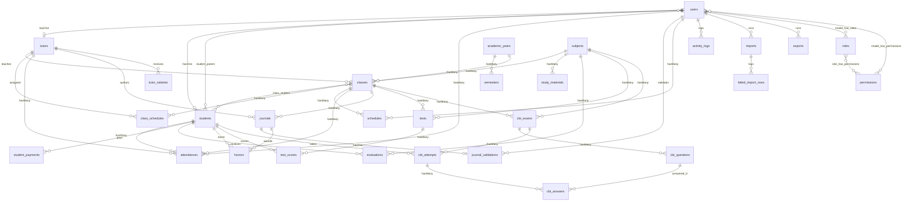

# Current Database Schema & ERD (`docs/ERD_CURRENT.md`)

## 1. Entity-Relationship Diagram

---

## 2. Tables & Columns

### Core Auth, Users & Permissions
- `users`: `id(bigint,pk)`, `username(string,unique,nullable)`, `name(string)`, `email(string,unique,nullable)`, `avatar_url(string,nullable)`, `role(string,default:'admin')`, `email_verified_at(timestamp,nullable)`, `password(string)`, `remember_token(string,nullable)`, `created_at(timestamp)`, `updated_at(timestamp)`
- `password_reset_tokens`: `email(string,pk)`, `token(string)`, `created_at(timestamp,nullable)`
- `sessions`: `id(string,pk)`, `user_id(bigint,fk->users.id,nullable)`, `ip_address(string,nullable)`, `user_agent(text,nullable)`, `payload(longtext)`, `last_activity(int)`
- `permissions`: `id(bigint,pk)`, `name(string)`, `guard_name(string)`, `created_at(timestamp)`, `updated_at(timestamp)`
- `roles`: `id(bigint,pk)`, `name(string)`, `guard_name(string)`, `created_at(timestamp)`, `updated_at(timestamp)`
- `model_has_permissions`: `permission_id(bigint,pk,fk->permissions.id)`, `model_type(string,pk)`, `model_id(bigint,pk)`
- `model_has_roles`: `role_id(bigint,pk,fk->roles.id)`, `model_type(string,pk)`, `model_id(bigint,pk)`
- `role_has_permissions`: `permission_id(bigint,pk,fk->permissions.id)`, `role_id(bigint,pk,fk->roles.id)`

### Academic & Master Data
- `academic_years`: `id(bigint,pk)`, `name(string)`, `is_active(boolean,default:false)`, `created_at(timestamp)`, `updated_at(timestamp)`, `deleted_at(timestamp,nullable)`
- `semesters`: `id(bigint,pk)`, `academic_year_id(bigint,fk->academic_years.id)`, `name(string)`, `start_date(date)`, `end_date(date)`, `is_active(boolean,default:false)`, `created_at(timestamp)`, `updated_at(timestamp)`, `deleted_at(timestamp,nullable)`
- `subjects`: `id(bigint,pk)`, `code(string,unique)`, `name(string)`, `description(text,nullable)`, `level(string,nullable)`, `is_active(boolean,default:true)`, `created_at(timestamp)`, `updated_at(timestamp)`, `deleted_at(timestamp,nullable)`
- `study_materials`: `id(bigint,pk)`, `subject_id(bigint,fk->subjects.id)`, `type(string,default:'mixed')`, `title(string)`, `description(text,nullable)`, `youtube_url(string,nullable)`, `mindmap_image(string,nullable)`, `attachment_file(string,nullable)`, `is_published(boolean,default:true)`, `created_at(timestamp)`, `updated_at(timestamp)`, `deleted_at(timestamp,nullable)`
- `classes` (Model: `ClassRoom`): `id(bigint,pk)`, `name(string)`, `academic_year_id(bigint,fk->academic_years.id,nullable)`, `subject_id(bigint,fk->subjects.id,nullable)`, `tutor_id(bigint,fk->tutors.id,nullable)`, `schedule(string,nullable)`, `capacity(int,default:20)`, `is_active(boolean,default:true)`, `created_at(timestamp)`, `updated_at(timestamp)`, `deleted_at(timestamp,nullable)`
- `class_student`: `id(bigint,pk)`, `class_id(bigint,fk->classes.id)`, `student_id(bigint,fk->students.id)`, `enrolled_at(date,nullable)`, `created_at(timestamp)`, `updated_at(timestamp)`
- `class_schedules`: `id(bigint,pk)`, `class_id(bigint,fk->classes.id)`, `tutor_id(bigint,fk->tutors.id,nullable)`, `schedule_items(json,nullable)`, `created_at(timestamp)`, `updated_at(timestamp)`
- `schedules`: `id(bigint,pk)`, `class_room_id(bigint,fk->classes.id)`, `user_id(bigint,fk->users.id)`, `date(date,nullable)`, `start_time(time)`, `end_time(time)`, `created_at(timestamp)`, `updated_at(timestamp)`

### HR, Students, Tutors & Admissions
- `admissions`: `id(bigint,pk)`, `registration_number(string,unique)`, `name(string)`, `birth_place(string,nullable)`, `birth_date(date,nullable)`, `gender(enum['L','P'],nullable)`, `religion(string,nullable)`, `email(string,nullable)`, `phone(string,nullable)`, `social_media(string,nullable)`, `level(string,nullable)`, `education_level(string,nullable)`, `course_level(string,nullable)`, `class_name(string,nullable)`, `address(text,nullable)`, `previous_school(string,nullable)`, `school_name(string,nullable)`, `parent_name(string,nullable)`, `parent_phone(string,nullable)`, `mother_name(string,nullable)`, `mother_phone(string,nullable)`, `mother_email(string,nullable)`, `mother_job(string,nullable)`, `father_name(string,nullable)`, `father_phone(string,nullable)`, `father_email(string,nullable)`, `father_job(string,nullable)`, `status(string,default:'pending')`, `tuition_fee(int,default:4000000)`, `registration_fee(int,default:100000)`, `has_discount(boolean,default:false)`, `total_fee(int,default:4100000)`, `payment_method(enum['full','installment'],nullable)`, `amount_paid(int,default:0)`, `notes(text,nullable)`, `created_at(timestamp)`, `updated_at(timestamp)`
- `students`: `id(bigint,pk)`, `user_id(bigint,fk->users.id,nullable)`, `nis(string,unique)`, `name(string)`, `birth_place(string,nullable)`, `gender(enum['L','P'],nullable)`, `religion(string,nullable)`, `birth_date(date,nullable)`, `address(text,nullable)`, `phone(string,nullable)`, `social_media(string,nullable)`, `education_level(string,nullable)`, `course_level(string,nullable)`, `class_name(string,nullable)`, `school_name(string,nullable)`, `parent_name(string,nullable)`, `parent_phone(string,nullable)`, `mother_name(string,nullable)`, `mother_phone(string,nullable)`, `mother_email(string,nullable)`, `mother_job(string,nullable)`, `father_name(string,nullable)`, `father_phone(string,nullable)`, `father_email(string,nullable)`, `father_job(string,nullable)`, `photo(string,nullable)`, `is_active(boolean,default:true)`, `created_at(timestamp)`, `updated_at(timestamp)`, `deleted_at(timestamp,nullable)`
- `student_parent`: `id(bigint,pk)`, `student_id(bigint,fk->students.id)`, `user_id(bigint,fk->users.id)`, `created_at(timestamp)`, `updated_at(timestamp)`
- `tutors`: `id(bigint,pk)`, `user_id(bigint,fk->users.id,nullable)`, `nip(string,unique,nullable)`, `name(string)`, `phone(string,nullable)`, `specialization(string,nullable)`, `grade(string,default:'C')`, `photo(string,nullable)`, `is_active(boolean,default:true)`, `created_at(timestamp)`, `updated_at(timestamp)`, `deleted_at(timestamp,nullable)`

### Daily Operations (Attendance & Teaching Journals)
- `attendances`: `id(bigint,pk)`, `role_type(string,default:'student')`, `class_id(bigint,fk->classes.id,nullable)`, `student_id(bigint,fk->students.id,nullable)`, `tutor_id(bigint,fk->tutors.id,nullable)`, `user_id(bigint,fk->users.id,nullable)`, `date(date)`, `status(enum['present','absent','late','excused'],default:'present')`, `time_in(time,nullable)`, `time_out(time,nullable)`, `notes(text,nullable)`, `created_at(timestamp)`, `updated_at(timestamp)`
- `journals`: `id(bigint,pk)`, `class_id(bigint,fk->classes.id)`, `tutor_id(bigint,fk->tutors.id)`, `date(date)`, `topic(string)`, `description(text,nullable)`, `materials(text,nullable)`, `jp_count(int,default:2)`, `status(enum['draft','submitted','validated','rejected'],default:'draft')`, `photo(json,nullable)`, `link(string,nullable)`, `created_at(timestamp)`, `updated_at(timestamp)`, `deleted_at(timestamp,nullable)`
- `journal_validations`: `id(bigint,pk)`, `journal_id(bigint,fk->journals.id)`, `validated_by(bigint,fk->users.id)`, `status(enum['approved','rejected'],default:'approved')`, `notes(text,nullable)`, `validated_at(timestamp,nullable)`, `created_at(timestamp)`, `updated_at(timestamp)`

### Evaluation, Honors & CBT Engine
- `evaluations`: `id(bigint,pk)`, `student_id(bigint,fk->students.id)`, `subject_id(bigint,fk->subjects.id)`, `score(int)`, `notes(text,nullable)`, `date(date)`, `created_at(timestamp)`, `updated_at(timestamp)`
- `honors`: `id(bigint,pk)`, `student_id(bigint,fk->students.id)`, `journal_id(bigint,fk->journals.id,nullable)`, `type(string,default:'achievement')`, `title(string)`, `description(text,nullable)`, `date(date)`, `certificate_number(string,nullable)`, `created_at(timestamp)`, `updated_at(timestamp)`, `deleted_at(timestamp,nullable)`
- `tests`: `id(bigint,pk)`, `class_id(bigint,fk->classes.id)`, `subject_id(bigint,fk->subjects.id,nullable)`, `name(string)`, `type(enum['daily','midterm','final'],default:'daily')`, `date(date)`, `max_score(int,default:100)`, `created_at(timestamp)`, `updated_at(timestamp)`, `deleted_at(timestamp,nullable)`
- `test_scores`: `id(bigint,pk)`, `test_id(bigint,fk->tests.id)`, `student_id(bigint,fk->students.id)`, `score(decimal(5,2),default:0)`, `notes(text,nullable)`, `created_at(timestamp)`, `updated_at(timestamp)`
- `cbt_exams`: `id(bigint,pk)`, `title(string)`, `description(text,nullable)`, `class_id(bigint,fk->classes.id)`, `subject_id(bigint,fk->subjects.id)`, `duration_minutes(int,default:120)`, `max_attempts(int,default:3)`, `is_active(boolean,default:true)`, `start_time(datetime,nullable)`, `end_time(datetime,nullable)`, `random_questions(boolean,default:true)`, `max_concurrent_users(int,nullable)`, `shuffle_questions(boolean,default:true)`, `shuffle_options(boolean,default:false)`, `show_result_immediately(boolean,default:true)`, `allow_review(boolean,default:false)`, `auto_save_interval(int,default:30)`, `created_at(timestamp)`, `updated_at(timestamp)`
- `cbt_questions`: `id(bigint,pk)`, `cbt_exam_id(bigint,fk->cbt_exams.id)`, `question_text(text)`, `attachment(string,nullable)`, `question_image(string,nullable)`, `option_a(text)`, `option_b(text)`, `option_c(text)`, `option_d(text)`, `option_e(text,nullable)`, `correct_answer(string(1))`, `points(int,default:1)`, `created_at(timestamp)`, `updated_at(timestamp)`
- `cbt_attempts`: `id(bigint,pk)`, `cbt_exam_id(bigint,fk->cbt_exams.id)`, `student_id(bigint,fk->students.id)`, `attempt_number(int,default:1)`, `start_time(datetime)`, `end_time(datetime,nullable)`, `status(enum['in_progress','finished','locked'],default:'in_progress')`, `score(decimal(8,2),nullable)`, `is_completed(boolean,default:false)`, `violation_count(int,default:0)`, `max_violations(int,default:3)`, `question_order(json,nullable)`, `is_force_submitted(boolean,default:false)`, `last_auto_save_at(timestamp,nullable)`, `created_at(timestamp)`, `updated_at(timestamp)`
- `cbt_answers`: `id(bigint,pk)`, `cbt_attempt_id(bigint,fk->cbt_attempts.id)`, `cbt_question_id(bigint,fk->cbt_questions.id)`, `selected_answer(string(1),nullable)`, `is_correct(boolean,default:false)`, `created_at(timestamp)`, `updated_at(timestamp)`

### Accounting & Finance
- `student_payments`: `id(bigint,pk)`, `student_id(bigint,fk->students.id)`, `month(int,nullable)`, `year(int,nullable)`, `amount(decimal(10,2))`, `due_date(date,nullable)`, `status(string,default:'unpaid')`, `paid_at(datetime,nullable)`, `notes(text,nullable)`, `created_at(timestamp)`, `updated_at(timestamp)`
- `tutor_salaries`: `id(bigint,pk)`, `tutor_id(bigint,fk->tutors.id)`, `month(int)`, `year(int)`, `total_jp(int,default:0)`, `total_amount(int,default:0)`, `status(enum['pending','paid'],default:'pending')`, `paid_at(date,nullable)`, `created_at(timestamp)`, `updated_at(timestamp)`
- `expenses`: `id(bigint,pk)`, `date(date)`, `category(string,default:'Operasional')`, `amount(decimal(12,2))`, `description(text,nullable)`, `created_at(timestamp)`, `updated_at(timestamp)`

### System, Notifications & Jobs
- `settings`: `id(bigint,pk)`, `key(string,unique)`, `value(text,nullable)`, `group(string,default:'general')`, `created_at(timestamp)`, `updated_at(timestamp)`
- `activity_logs`: `id(bigint,pk)`, `user_id(bigint,fk->users.id,nullable)`, `action(string)`, `description(text,nullable)`, `ip(string,nullable)`, `user_agent(string,nullable)`, `page(string,nullable)`, `created_at(timestamp)`, `updated_at(timestamp)`
- `notifications`: `id(uuid,pk)`, `type(string)`, `notifiable_type(string)`, `notifiable_id(bigint)`, `data(text)`, `read_at(timestamp,nullable)`, `created_at(timestamp)`, `updated_at(timestamp)`
- `push_subscriptions`: `id(bigint,pk)`, `subscribable_type(string)`, `subscribable_id(bigint)`, `endpoint(string(500),unique)`, `public_key(string,nullable)`, `auth_token(string,nullable)`, `content_encoding(string,nullable)`, `created_at(timestamp)`, `updated_at(timestamp)`
- `imports`: `id(bigint,pk)`, `completed_at(timestamp,nullable)`, `file_name(string)`, `file_path(string)`, `importer(string)`, `processed_rows(uint,default:0)`, `total_rows(uint)`, `successful_rows(uint,default:0)`, `user_id(bigint,fk->users.id)`, `created_at(timestamp)`, `updated_at(timestamp)`
- `exports`: `id(bigint,pk)`, `completed_at(timestamp,nullable)`, `file_disk(string)`, `file_name(string,nullable)`, `exporter(string)`, `processed_rows(uint,default:0)`, `total_rows(uint)`, `successful_rows(uint,default:0)`, `user_id(bigint,fk->users.id)`, `created_at(timestamp)`, `updated_at(timestamp)`
- `failed_import_rows`: `id(bigint,pk)`, `data(json)`, `import_id(bigint,fk->imports.id)`, `validation_error(text,nullable)`, `created_at(timestamp)`, `updated_at(timestamp)`
- `cache` / `cache_locks`: `key(string,pk)`, `value(mediumtext)` / `owner(string)`, `expiration(bigint)`
- `jobs` / `job_batches` / `failed_jobs`: standard Laravel queue tables
