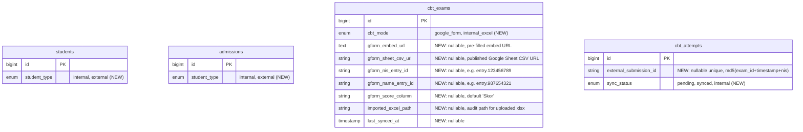

# Entity Relationship Diagram V2 (Dual-Mode CBT + VPS 1GB Optimization)

## Schema Delta & Migrations (`V2`)

1. **`2026_11_21_000001_add_student_type_to_students_and_admissions.php`**:
   - `students`: add `student_type` ENUM(`internal`, `external`) default `internal` after `nis`.
   - `admissions`: add `student_type` ENUM(`internal`, `external`) default `internal` after `registration_number`.

2. **`2026_11_21_000002_add_dual_mode_columns_to_cbt_exams.php`**:
   - `cbt_exams`:
     - `cbt_mode` ENUM(`google_form`, `internal_excel`) default `google_form` after `subject_id`
     - `gform_embed_url` TEXT nullable
     - `gform_sheet_csv_url` TEXT nullable
     - `gform_nis_entry_id` VARCHAR(100) nullable
     - `gform_name_entry_id` VARCHAR(100) nullable
     - `gform_score_column` VARCHAR(100) default `'Skor'`
     - `imported_excel_path` VARCHAR(255) nullable
     - `last_synced_at` TIMESTAMP nullable

3. **`2026_11_21_000003_add_sync_columns_to_cbt_attempts.php`**:
   - `cbt_attempts`:
     - `external_submission_id` VARCHAR(191) nullable unique
     - `sync_status` ENUM(`pending`, `synced`, `internal`) default `internal`

4. **`2026_11_21_000004_add_performance_indexes.php`**:
   - `attendances`: index on `(date, role_type, student_id)` and `(date, role_type, tutor_id)`.
   - `cbt_attempts`: index on `(cbt_exam_id, student_id)`.
