# 📊 Entity Relationship Diagram (ERD)
## G-English — Learning Management System

**Database:** MySQL 8.4.3 | **Total Tabel:** 47 (27 tabel utama + 20 tabel sistem)

---

## Diagram ERD (Mermaid)

```mermaid
erDiagram
    users {
        bigint id PK
        varchar username UK
        varchar name
        varchar email UK
        varchar password
        varchar role "admin|tutor|siswa|parent"
        varchar avatar_url "Cloudflare R2"
        timestamp email_verified_at
        varchar remember_token
        timestamps created_at
        timestamps updated_at
    }

    students {
        bigint id PK
        bigint user_id FK
        varchar nis UK
        varchar name
        varchar gender
        date birth_date
        varchar birth_place
        text address
        varchar phone
        varchar father_name
        varchar father_phone
        varchar father_email
        varchar father_job
        varchar mother_name
        varchar mother_phone
        varchar mother_email
        varchar mother_job
        varchar photo "Cloudflare R2"
        varchar religion
        varchar social_media
        varchar education_level
        varchar course_level
        varchar class_name
        varchar school_name
        boolean is_active
        timestamps created_at
        timestamp deleted_at
    }

    tutors {
        bigint id PK
        bigint user_id FK
        varchar nip UK
        varchar name
        varchar phone
        varchar specialization
        varchar grade
        varchar photo "Cloudflare R2"
        boolean is_active
        timestamps created_at
        timestamp deleted_at
    }

    academic_years {
        bigint id PK
        varchar name "e.g. 2025/2026"
        boolean is_active
        timestamps created_at
        timestamp deleted_at
    }

    semesters {
        bigint id PK
        bigint academic_year_id FK
        varchar name "Ganjil|Genap"
        date start_date
        date end_date
        boolean is_active
        timestamps created_at
        timestamp deleted_at
    }

    subjects {
        bigint id PK
        varchar name
        varchar code UK
        text description
        timestamps created_at
        timestamp deleted_at
    }

    classes {
        bigint id PK
        bigint academic_year_id FK
        bigint tutor_id FK
        bigint subject_id FK
        varchar name
        varchar level "SD|SMP|SMA"
        int capacity
        timestamps created_at
        timestamp deleted_at
    }

    class_student {
        bigint id PK
        bigint class_id FK
        bigint student_id FK
        date enrolled_at
        timestamps created_at
    }

    class_schedules {
        bigint id PK
        bigint class_id FK
        bigint tutor_id FK
        json schedule_items "day, start_time, end_time"
        timestamps created_at
    }

    attendances {
        bigint id PK
        varchar role_type "student|tutor"
        bigint class_id FK
        bigint student_id FK
        bigint tutor_id FK
        bigint user_id FK
        date date
        varchar status "hadir|izin|sakit|alpa"
        time time_in
        time time_out
        text notes
        timestamps created_at
    }

    journals {
        bigint id PK
        bigint class_id FK
        bigint tutor_id FK
        date date
        varchar topic
        text description
        text materials
        int jp_count "Jam Pelajaran"
        varchar status "submitted|validated|rejected"
        json photo "Array foto Cloudflare R2"
        varchar link
        timestamps created_at
        timestamp deleted_at
    }

    journal_validations {
        bigint id PK
        bigint journal_id FK
        bigint validated_by FK "users.id"
        varchar status "approved|rejected"
        text notes
        datetime validated_at
        timestamps created_at
    }

    tests {
        bigint id PK
        bigint class_id FK
        bigint subject_id FK
        varchar name
        varchar type "UTS|UAS|Quiz"
        date date
        int max_score
        timestamps created_at
        timestamp deleted_at
    }

    test_scores {
        bigint id PK
        bigint test_id FK
        bigint student_id FK
        decimal score
        text notes
        timestamps created_at
    }

    cbt_exams {
        bigint id PK
        varchar title
        text description
        bigint class_id FK
        bigint subject_id FK
        int duration_minutes
        int max_attempts
        boolean is_active
        datetime start_time
        datetime end_time
        boolean shuffle_questions
        boolean shuffle_options
        boolean show_result_immediately
        boolean allow_review
        int auto_save_interval
        int max_concurrent_users
        timestamps created_at
    }

    cbt_questions {
        bigint id PK
        bigint cbt_exam_id FK
        text question_text
        varchar attachment "Cloudflare R2"
        text option_a
        text option_b
        text option_c
        text option_d
        text option_e
        varchar correct_answer "a|b|c|d|e"
        int points
        timestamps created_at
    }

    cbt_attempts {
        bigint id PK
        bigint cbt_exam_id FK
        bigint student_id FK
        int attempt_number
        datetime start_time
        datetime end_time
        varchar status "in_progress|completed|timeout"
        decimal score
        boolean is_completed
        int violation_count
        int max_violations
        json question_order
        boolean is_force_submitted
        datetime last_auto_save_at
        timestamps created_at
    }

    cbt_answers {
        bigint id PK
        bigint cbt_attempt_id FK
        bigint cbt_question_id FK
        varchar selected_answer
        boolean is_correct
        timestamps created_at
    }

    evaluations {
        bigint id PK
        bigint student_id FK
        bigint subject_id FK
        varchar semester
        varchar grade
        text remarks
        timestamps created_at
    }

    student_payments {
        bigint id PK
        bigint student_id FK
        int month
        int year
        decimal amount
        varchar status "paid|unpaid|overdue"
        date due_date
        datetime paid_at
        text notes
        timestamps created_at
    }

    tutor_salaries {
        bigint id PK
        bigint tutor_id FK
        int month
        int year
        int total_jp
        decimal total_amount
        varchar status "paid|unpaid"
        date paid_at
        timestamps created_at
    }

    expenses {
        bigint id PK
        date date
        varchar category
        decimal amount
        text description
        timestamps created_at
    }

    honors {
        bigint id PK
        bigint student_id FK
        bigint journal_id FK
        varchar type "achievement|warning"
        varchar title
        text description
        date date
        varchar certificate_number
        timestamps created_at
        timestamp deleted_at
    }

    admissions {
        bigint id PK
        varchar registration_number UK "REG-YYYY-XXXX"
        varchar name
        varchar email
        varchar phone
        varchar level "SD|SMP|SMA"
        date birth_date
        varchar birth_place
        varchar gender
        varchar religion
        text address
        varchar previous_school
        varchar parent_name
        varchar parent_phone
        varchar father_name
        varchar father_phone
        varchar father_email
        varchar father_job
        varchar mother_name
        varchar mother_phone
        varchar mother_email
        varchar mother_job
        varchar social_media
        varchar education_level
        varchar course_level
        varchar class_name
        varchar school_name
        decimal tuition_fee
        decimal registration_fee
        boolean has_discount
        decimal total_fee
        varchar payment_method
        decimal amount_paid
        varchar status "pending|accepted|rejected"
        text notes
        timestamps created_at
    }

    schedules {
        bigint id PK
        bigint class_id FK
        bigint user_id FK
        date date
        text notes
        timestamps created_at
    }

    study_materials {
        bigint id PK
        bigint subject_id FK
        varchar type "video|mindmap|file"
        varchar title
        text description
        varchar youtube_url
        varchar mindmap_image "Cloudflare R2"
        varchar attachment_file "Cloudflare R2"
        boolean is_published
        timestamps created_at
        timestamp deleted_at
    }

    student_parent {
        bigint id PK
        bigint student_id FK
        bigint user_id FK "parent user"
        timestamps created_at
    }

    settings {
        bigint id PK
        varchar key UK
        text value
        varchar group
        timestamps created_at
    }

    activity_logs {
        bigint id PK
        bigint user_id FK
        varchar action
        text description
        varchar ip
        text user_agent
        varchar page
        timestamps created_at
    }

    %% === RELATIONSHIPS ===

    users ||--o| students : "has one"
    users ||--o| tutors : "has one"
    users ||--o{ attendances : "records"
    users ||--o{ journal_validations : "validates"
    users ||--o{ activity_logs : "generates"
    users }o--o{ students : "student_parent (parents)"

    students }o--o{ classes : "class_student"
    students ||--o{ attendances : "has"
    students ||--o{ test_scores : "has"
    students ||--o{ honors : "earns"
    students ||--o{ cbt_attempts : "takes"
    students ||--o{ student_payments : "pays"
    students ||--o{ evaluations : "receives"

    tutors ||--o{ classes : "teaches"
    tutors ||--o{ tutor_salaries : "receives"
    tutors ||--o{ attendances : "records"
    tutors ||--o{ journals : "writes"
    tutors ||--o{ class_schedules : "scheduled"

    academic_years ||--o{ semesters : "contains"
    academic_years ||--o{ classes : "belongs to"

    classes ||--o{ attendances : "for"
    classes ||--o{ journals : "for"
    classes ||--o{ tests : "for"
    classes ||--o{ class_schedules : "has"
    classes ||--o{ cbt_exams : "for"
    classes ||--o{ schedules : "has"

    subjects ||--o{ classes : "taught in"
    subjects ||--o{ tests : "for"
    subjects ||--o{ cbt_exams : "for"
    subjects ||--o{ study_materials : "has"
    subjects ||--o{ evaluations : "for"

    tests ||--o{ test_scores : "has"

    journals ||--o| journal_validations : "has"
    journals ||--o{ honors : "linked"

    cbt_exams ||--o{ cbt_questions : "contains"
    cbt_exams ||--o{ cbt_attempts : "has"

    cbt_attempts ||--o{ cbt_answers : "contains"
    cbt_questions ||--o{ cbt_answers : "answered in"
```

---

## Ringkasan Relasi Antar Tabel

### Relasi One-to-One
| Tabel A | Tabel B | Keterangan |
|---|---|---|
| `users` | `students` | Setiap siswa punya 1 akun user |
| `users` | `tutors` | Setiap tutor punya 1 akun user |
| `journals` | `journal_validations` | Setiap jurnal punya 1 validasi |

### Relasi One-to-Many
| Parent | Child | Keterangan |
|---|---|---|
| `academic_years` | `semesters` | Tahun ajaran memiliki banyak semester |
| `academic_years` | `classes` | Tahun ajaran memiliki banyak kelas |
| `tutors` | `classes` | Tutor mengajar banyak kelas |
| `subjects` | `classes` | Mata pelajaran diajar di banyak kelas |
| `classes` | `attendances` | Kelas punya banyak absensi |
| `classes` | `journals` | Kelas punya banyak jurnal |
| `classes` | `tests` | Kelas punya banyak tes |
| `classes` | `cbt_exams` | Kelas punya banyak ujian CBT |
| `classes` | `class_schedules` | Kelas punya banyak jadwal |
| `tutors` | `journals` | Tutor menulis banyak jurnal |
| `tutors` | `tutor_salaries` | Tutor punya banyak riwayat gaji |
| `students` | `attendances` | Siswa punya banyak absensi |
| `students` | `test_scores` | Siswa punya banyak nilai tes |
| `students` | `honors` | Siswa punya banyak penghargaan |
| `students` | `cbt_attempts` | Siswa punya banyak percobaan ujian |
| `students` | `student_payments` | Siswa punya banyak riwayat pembayaran |
| `students` | `evaluations` | Siswa punya banyak evaluasi |
| `tests` | `test_scores` | Tes punya banyak skor |
| `cbt_exams` | `cbt_questions` | Ujian CBT punya banyak soal |
| `cbt_exams` | `cbt_attempts` | Ujian CBT punya banyak percobaan |
| `cbt_attempts` | `cbt_answers` | Percobaan punya banyak jawaban |
| `subjects` | `study_materials` | Mata pelajaran punya banyak materi |
| `users` | `activity_logs` | User punya banyak log aktivitas |

### Relasi Many-to-Many
| Tabel A | Pivot | Tabel B | Keterangan |
|---|---|---|---|
| `students` | `class_student` | `classes` | Siswa terdaftar di banyak kelas |
| `users (parent)` | `student_parent` | `students` | Orang tua punya banyak anak, anak punya banyak orang tua |

---

## Tabel Pendukung Sistem

| Tabel | Fungsi |
|---|---|
| `migrations` | Riwayat migrasi database Laravel |
| `sessions` | Session management |
| `cache`, `cache_locks` | Cache system |
| `jobs`, `job_batches`, `failed_jobs` | Queue system |
| `password_reset_tokens` | Reset password tokens |
| `notifications` | Database notifications (Filament) |
| `push_subscriptions` | WebPush subscriptions |
| `permissions`, `roles` | Spatie Permission (RBAC) |
| `model_has_permissions`, `model_has_roles`, `role_has_permissions` | Spatie pivot tables |
| `imports`, `exports`, `failed_import_rows` | Filament import/export |

---

## Catatan Penyimpanan File

Semua file media disimpan di **Cloudflare R2** (S3-compatible object storage):

| Field | Tabel | Direktori R2 |
|---|---|---|
| `avatar_url` | `users` | `avatars/` |
| `photo` | `students`, `tutors` | (root/custom) |
| `photo` | `journals` | JSON array paths |
| `attachment` | `cbt_questions` | (exam attachments) |
| `mindmap_image` | `study_materials` | (study materials) |
| `attachment_file` | `study_materials` | (study materials) |
