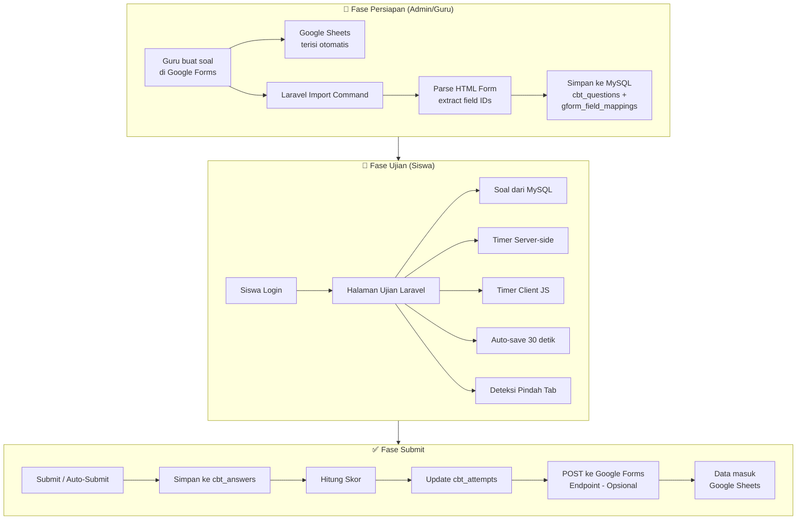
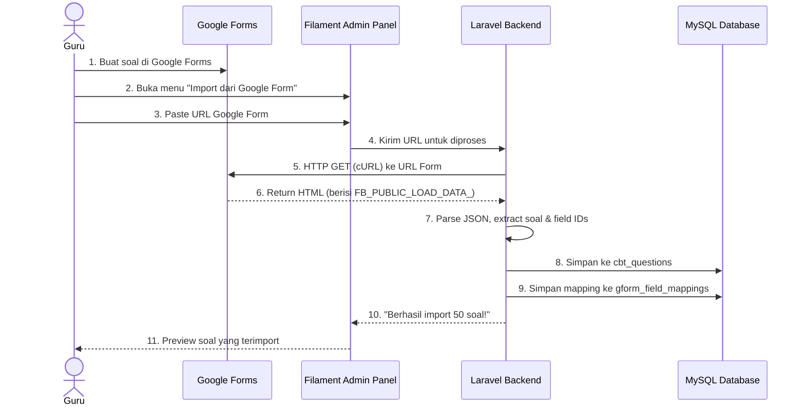
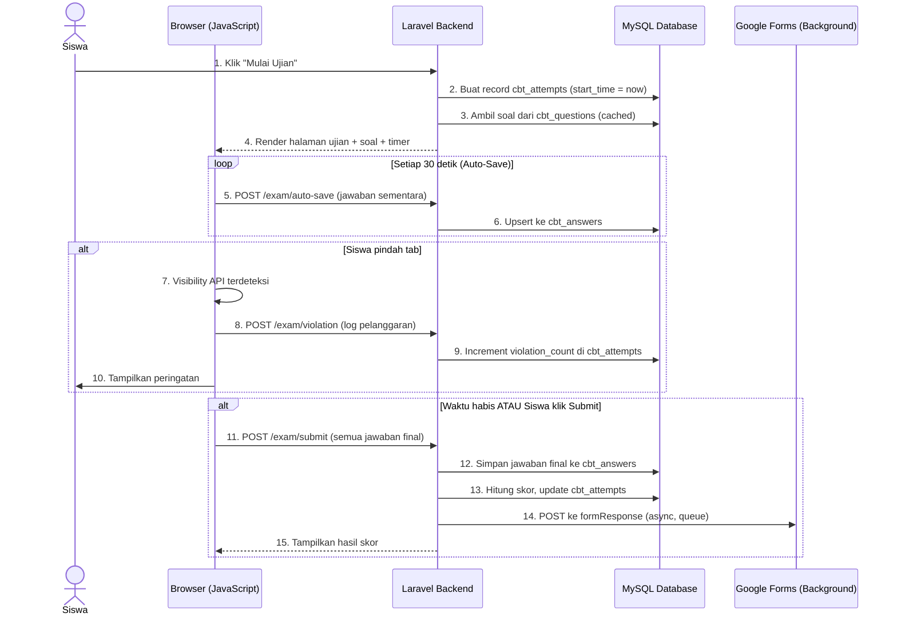
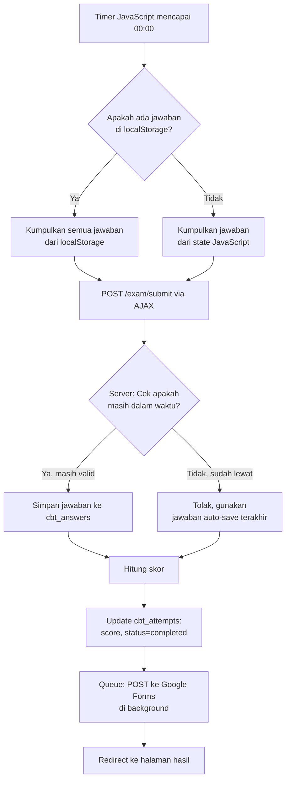
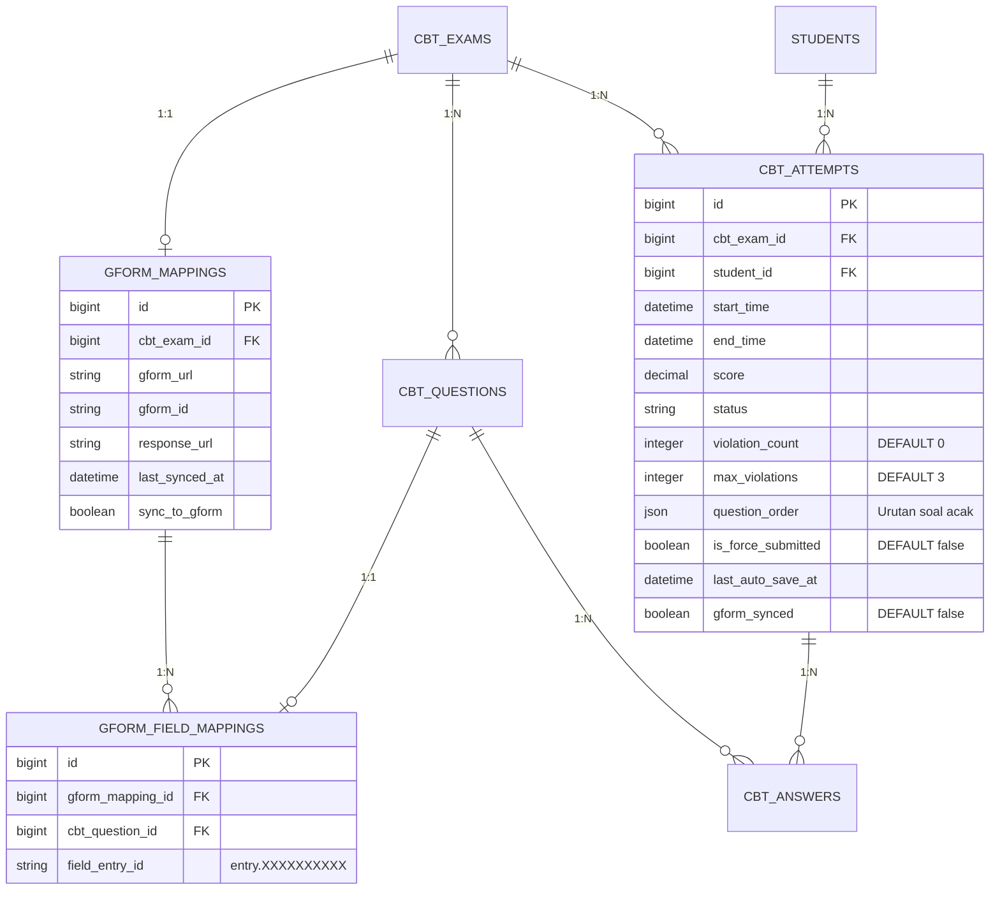

# Skema Integrasi Google Forms × Laravel CBT Engine
## G-English — Dokumen Teknis Arsitektur

> **Tujuan:** Memanfaatkan Google Forms sebagai "pembuat soal" sekaligus "mesin ujian" yang dibungkus sepenuhnya oleh aplikasi Laravel, dengan kontrol penuh atas timer, anti-curang, auto-submit, dan penyimpanan jawaban independen.
>
> **Prinsip:** Semua tools yang digunakan **100% gratis**. Tidak ada biaya lisensi atau layanan berbayar.

---

## Daftar Isi

1. [Gambaran Arsitektur Besar](#1-gambaran-arsitektur-besar)
2. [Teknik Inti: Parse & Rebuild](#2-teknik-inti-parse--rebuild)
3. [Alur Kerja End-to-End](#3-alur-kerja-end-to-end)
4. [Skema Database (Tabel Baru & Modifikasi)](#4-skema-database-tabel-baru--modifikasi)
5. [Komponen Backend (Laravel)](#5-komponen-backend-laravel)
6. [Komponen Frontend (JavaScript)](#6-komponen-frontend-javascript)
7. [Fitur 1: Timer & Auto-Submit](#7-fitur-1-timer--auto-submit)
8. [Fitur 2: Anti-Curang (Deteksi Pindah Tab)](#8-fitur-2-anti-curang-deteksi-pindah-tab)
9. [Fitur 3: Auto-Save Jawaban Independen](#9-fitur-3-auto-save-jawaban-independen)
10. [Fitur 4: Sinkronisasi ke Google Sheets (Opsional)](#10-fitur-4-sinkronisasi-ke-google-sheets-opsional)
11. [Pembagian Sesi untuk 1.000 User/Hari](#11-pembagian-sesi-untuk-1000-userhari)
12. [Keamanan & Mitigasi Risiko](#12-keamanan--mitigasi-risiko)
13. [Daftar Tools & Library (Semua Gratis)](#13-daftar-tools--library-semua-gratis)
14. [Roadmap Implementasi](#14-roadmap-implementasi)

---

## 1. Gambaran Arsitektur Besar

```
┌─────────────────────────────────────────────────────────────────────┐
│                        FASE PERSIAPAN (Admin/Guru)                 │
│                                                                     │
│   Guru buat soal di Google Forms ──► Google Sheets (otomatis)      │
│                          │                                          │
│                          ▼                                          │
│   Laravel: Artisan Command / Filament Action                       │
│   "Import Soal dari Google Forms"                                  │
│       │                                                             │
│       ├── 1. Ambil HTML Google Form (cURL/Http client)             │
│       ├── 2. Parse field IDs (entry.XXXXX) + teks soal + opsi     │
│       ├── 3. Simpan ke tabel `cbt_questions` di MySQL              │
│       └── 4. Simpan mapping field ID ke `gform_field_mappings`     │
│                                                                     │
└─────────────────────────────────────────────────────────────────────┘
                              │
                              ▼
┌─────────────────────────────────────────────────────────────────────┐
│                      FASE UJIAN (Siswa)                            │
│                                                                     │
│   Siswa login ──► Halaman Ujian (100% milik Laravel)               │
│       │                                                             │
│       ├── Soal diambil dari MySQL (BUKAN dari Google Forms)        │
│       ├── Timer server-side (start_time di cbt_attempts)           │
│       ├── Timer client-side (countdown JavaScript)                 │
│       ├── Auto-save jawaban ke MySQL setiap 30 detik               │
│       ├── Deteksi pindah tab (Page Visibility API)                 │
│       └── Auto-submit saat waktu habis                             │
│                                                                     │
│   Saat SUBMIT (atau Auto-Submit):                                  │
│       ├── 1. Simpan semua jawaban final ke `cbt_answers`           │
│       ├── 2. Hitung skor, update `cbt_attempts`                   │
│       └── 3. (Opsional) POST jawaban ke Google Forms endpoint      │
│              agar data juga masuk Google Sheets                    │
│                                                                     │
└─────────────────────────────────────────────────────────────────────┘
```

### Diagram Mermaid — Arsitektur Sistem



> **Kunci Utama:** Google Forms hanya dipakai sebagai **alat buat soal** (karena UI-nya familiar untuk guru) dan sebagai **backup data** (via Google Sheets). Saat ujian berlangsung, **Google Forms TIDAK terlibat sama sekali**. Semua berjalan di server Laravel Anda.

---

## 2. Teknik Inti: Parse & Rebuild

### 2.1 Anatomi Google Form

Setiap Google Form memiliki struktur URL:
```
https://docs.google.com/forms/d/e/{FORM_ID}/viewform
```

Di dalam HTML-nya terdapat data terstruktur berupa JavaScript object (`FB_PUBLIC_LOAD_DATA_`), yang berisi:
- Semua teks pertanyaan
- Semua opsi jawaban
- Field ID untuk setiap pertanyaan (format: `entry.XXXXXXXXXX`)
- Tipe pertanyaan (pilihan ganda, checkbox, teks, dll)

### 2.2 Cara Extract Data dari Google Form

Ada **2 pendekatan** untuk mengambil data soal:

#### Pendekatan A: Parse HTML dengan cURL (Direkomendasikan)

```
ALUR:
1. HTTP GET ke URL Google Form
2. Cari pattern `FB_PUBLIC_LOAD_DATA_` dalam HTML
3. Decode JSON array yang berisi semua soal
4. Map ke struktur database kita
```

**Struktur data `FB_PUBLIC_LOAD_DATA_`:**
```
Array utama:
  [1] → Array pertanyaan
    [0] → ID internal Google
    [1] → Teks pertanyaan
    [3] → Tipe pertanyaan (0=text, 2=radio, 4=checkbox)
    [4] → Array opsi jawaban
      [0] → Array per opsi
        [0] → Teks opsi
    [4][0][x][0] → Teks setiap opsi

  Field ID (entry.XXX) ada di:
    pertanyaan[4][0][0][x] → nomor field
    Formatnya: entry.{nomor}
```

#### Pendekatan B: Google Sheets API (Alternatif)

Jika guru menautkan Google Form ke Spreadsheet:
1. Baca header kolom Spreadsheet = teks pertanyaan
2. Admin mapping manual field ID (sekali saja per form)
3. Lebih stabil, tidak bergantung parsing HTML

### 2.3 Endpoint Submit Google Forms

Untuk mengirim jawaban ke Google Forms (agar masuk Google Sheets), POST ke:
```
POST https://docs.google.com/forms/d/e/{FORM_ID}/formResponse

Content-Type: application/x-www-form-urlencoded

Body: entry.123456789=Jawaban1&entry.987654321=Jawaban2&...
```

> **Catatan:** Response dari Google bisa diabaikan (fire-and-forget). Yang penting data masuk Sheets.

---

## 3. Alur Kerja End-to-End

### 3.1 Alur Admin: Import Soal dari Google Form



### 3.2 Alur Siswa: Mengerjakan Ujian



### 3.3 Alur Detail: Apa yang Terjadi Saat Auto-Submit



---

## 4. Skema Database (Tabel Baru & Modifikasi)

### 4.1 Tabel Baru: `gform_mappings`

Menyimpan hubungan antara Google Form dan CBT Exam.

```
┌─────────────────────────────────────────────────────────────────┐
│                        gform_mappings                           │
├──────────────────┬──────────────┬────────────────────────────── │
│ Kolom            │ Tipe         │ Keterangan                    │
├──────────────────┼──────────────┼───────────────────────────────│
│ id               │ bigint PK    │ Auto increment                │
│ cbt_exam_id      │ bigint FK    │ → cbt_exams.id                │
│ gform_url        │ string       │ URL lengkap Google Form       │
│ gform_id         │ string       │ ID Form (extract dari URL)    │
│ response_url     │ string       │ URL endpoint formResponse     │
│ last_synced_at   │ datetime     │ Kapan terakhir diimport       │
│ sync_to_gform    │ boolean      │ Apakah jawaban dikirim ke GF  │
│ created_at       │ timestamp    │                               │
│ updated_at       │ timestamp    │                               │
└──────────────────┴──────────────┴───────────────────────────────┘
```

### 4.2 Tabel Baru: `gform_field_mappings`

Menyimpan mapping antara field Google Form dan pertanyaan CBT.

```
┌──────────────────────────────────────────────────────────────────┐
│                     gform_field_mappings                          │
├──────────────────┬──────────────┬─────────────────────────────── │
│ Kolom            │ Tipe         │ Keterangan                     │
├──────────────────┼──────────────┼────────────────────────────────│
│ id               │ bigint PK    │ Auto increment                 │
│ gform_mapping_id │ bigint FK    │ → gform_mappings.id            │
│ cbt_question_id  │ bigint FK    │ → cbt_questions.id             │
│ field_entry_id   │ string       │ "entry.1234567890"             │
│ created_at       │ timestamp    │                                │
│ updated_at       │ timestamp    │                                │
└──────────────────┴──────────────┴────────────────────────────────┘
```

### 4.3 Modifikasi Tabel: `cbt_attempts` (Kolom Baru)

```
┌──────────────────────────────────────────────────────────────────┐
│                 cbt_attempts (kolom BARU)                         │
├───────────────────────┬──────────────┬───────────────────────────│
│ Kolom                 │ Tipe         │ Keterangan                │
├───────────────────────┼──────────────┼───────────────────────────│
│ violation_count       │ integer      │ DEFAULT 0                 │
│                       │              │ Jumlah kali pindah tab    │
│ max_violations        │ integer      │ DEFAULT 3                 │
│                       │              │ Batas maks pelanggaran    │
│ question_order        │ json         │ NULLABLE                  │
│                       │              │ Urutan soal acak [5,2,8]  │
│ is_force_submitted    │ boolean      │ DEFAULT false             │
│                       │              │ True jika auto-submit     │
│ last_auto_save_at     │ datetime     │ NULLABLE                  │
│                       │              │ Waktu auto-save terakhir  │
│ gform_synced          │ boolean      │ DEFAULT false             │
│                       │              │ Sudah dikirim ke GForm?   │
└───────────────────────┴──────────────┴───────────────────────────┘
```

### 4.4 ERD Relasi Lengkap (CBT + Google Form)



---

## 5. Komponen Backend (Laravel)

### 5.1 Daftar File yang Perlu Dibuat/Dimodifikasi

```
app/
├── Models/
│   ├── GformMapping.php                    [NEW]
│   └── GformFieldMapping.php              [NEW]
│
├── Services/
│   └── GoogleForm/
│       ├── GoogleFormParser.php            [NEW] — Parse HTML Google Form
│       ├── GoogleFormImporter.php          [NEW] — Import soal ke database
│       └── GoogleFormSubmitter.php         [NEW] — POST jawaban ke GForm
│
├── Http/
│   └── Controllers/
│       └── Cbt/
│           ├── ExamController.php         [NEW] — Render halaman ujian
│           ├── ExamApiController.php      [NEW] — API: auto-save, submit, violation
│           └── ExamTimerMiddleware.php     [NEW] — Validasi waktu server-side
│
├── Jobs/
│   └── SyncAnswersToGoogleForm.php        [NEW] — Queue job POST ke GForm
│
├── Console/
│   └── Commands/
│       └── ImportGoogleFormCommand.php     [NEW] — Artisan: php artisan gform:import {url}
│
└── Filament/
    └── Resources/
        └── Cbt/
            └── CbtExamResource/
                └── Actions/
                    └── ImportFromGoogleFormAction.php  [NEW] — Tombol import di Filament

database/
└── migrations/
    ├── xxxx_create_gform_mappings_table.php             [NEW]
    ├── xxxx_create_gform_field_mappings_table.php        [NEW]
    └── xxxx_add_exam_control_columns_to_cbt_attempts.php [NEW]

resources/
└── views/
    └── cbt/
        ├── exam.blade.php                 [NEW] — Layout halaman ujian (fullscreen)
        ├── partials/
        │   ├── question-card.blade.php    [NEW] — Komponen per soal
        │   ├── timer.blade.php            [NEW] — Widget timer
        │   └── navigation.blade.php       [NEW] — Navigasi soal (1-50)
        └── result.blade.php               [NEW] — Halaman hasil ujian

routes/
└── web.php                                [MODIFY] — Tambah route exam
```

### 5.2 Service: GoogleFormParser

**Tugas:** Mengambil dan mem-parse HTML Google Form untuk mengekstrak soal.

```
PSEUDOCODE:

class GoogleFormParser
    method parse(string $formUrl): array
        1. $html = Http::get($formUrl)->body()
        2. Cari regex pattern: /FB_PUBLIC_LOAD_DATA_ = (.+?);<\/script>/
        3. $rawData = json_decode(match)
        4. Loop setiap item di $rawData[1][1]:
           - $questionText  = item[1]
           - $questionType  = item[3]  (2=radio/pilihan ganda)
           - $fieldEntryId  = "entry." . item[4][0][0][4][0][0]
           - $options        = map item[4][0][1] → extract [0] dari tiap opsi
        5. Return array of:
           [
             'question_text' => "What is...?",
             'field_entry_id' => "entry.1234567890",
             'type' => 'radio',
             'options' => ['Tokyo', 'Kyoto', 'Osaka', 'Nagoya'],
           ]
```

### 5.3 Service: GoogleFormImporter

**Tugas:** Menyimpan hasil parsing ke database.

```
PSEUDOCODE:

class GoogleFormImporter
    method import(int $cbtExamId, string $formUrl): int
        1. $parsedQuestions = GoogleFormParser::parse($formUrl)

        2. Buat/update GformMapping:
           - cbt_exam_id = $cbtExamId
           - gform_url = $formUrl
           - gform_id = extract dari URL
           - response_url = replace '/viewform' dengan '/formResponse'

        3. Loop setiap $question:
           - Buat CbtQuestion:
             - cbt_exam_id = $cbtExamId
             - question_text = $question['question_text']
             - option_a = $question['options'][0]
             - option_b = $question['options'][1]
             - option_c = $question['options'][2]
             - option_d = $question['options'][3]
             - option_e = $question['options'][4] ?? null
             - correct_answer = null (guru set manual nanti)
             - points = default (10)

           - Buat GformFieldMapping:
             - cbt_question_id = $cbtQuestion->id
             - field_entry_id = $question['field_entry_id']

        4. Return jumlah soal yang diimport
```

> **Catatan soal `correct_answer`:** Google Form menyimpan jawaban benar, tapi **tersembunyi** dan berbeda tergantung setting form (bisa jadi tidak ada jika guru tidak aktifkan "show score"). Oleh karena itu, guru perlu **set jawaban benar secara manual** di Filament setelah import, atau diparse dari form jika tersedia.

### 5.4 Service: GoogleFormSubmitter

**Tugas:** Mengirim jawaban siswa ke Google Forms endpoint (agar masuk Google Sheets).

```
PSEUDOCODE:

class GoogleFormSubmitter
    method submit(CbtAttempt $attempt): bool
        1. $mapping = GformMapping::where('cbt_exam_id', $attempt->cbt_exam_id)->first()
        2. Jika !$mapping atau !$mapping->sync_to_gform → return false

        3. $answers = $attempt->answers()->with('question.gformFieldMapping')->get()

        4. $formData = []
        5. Loop setiap $answer:
           - $fieldId = $answer->question->gformFieldMapping->field_entry_id
           - $formData[$fieldId] = $answer->selected_answer

        6. Http::asForm()->post($mapping->response_url, $formData)

        7. $attempt->update(['gform_synced' => true])
        8. Return true
```

### 5.5 API Endpoints

| Method | Route | Controller Method | Fungsi |
|---|---|---|---|
| `GET` | `/exam/{exam}/start` | `ExamController@start` | Mulai ujian, buat attempt |
| `GET` | `/exam/{attempt}` | `ExamController@show` | Render halaman ujian |
| `POST` | `/exam/{attempt}/auto-save` | `ExamApiController@autoSave` | Simpan jawaban sementara |
| `POST` | `/exam/{attempt}/submit` | `ExamApiController@submit` | Submit final |
| `POST` | `/exam/{attempt}/violation` | `ExamApiController@violation` | Log pindah tab |
| `GET` | `/exam/{attempt}/time-remaining` | `ExamApiController@timeRemaining` | Sisa waktu (server) |
| `GET` | `/exam/{attempt}/result` | `ExamController@result` | Halaman hasil |

### 5.6 Middleware: Validasi Waktu Server-Side

```
PSEUDOCODE:

class ExamTimerMiddleware
    method handle($request, $next)
        1. $attempt = CbtAttempt::find($request->route('attempt'))
        2. $exam = $attempt->exam

        3. $startTime = $attempt->start_time
        4. $maxEndTime = $startTime->addMinutes($exam->duration_minutes)

        5. Jika now() > $maxEndTime:
           - Jika $attempt->status != 'completed':
             - Tandai completed, hitung skor dari jawaban auto-save terakhir
           - Return response: {"error": "Waktu ujian telah habis", "redirect": "/exam/{attempt}/result"}

        6. Return $next($request)
```

---

## 6. Komponen Frontend (JavaScript)

### 6.1 Struktur Halaman Ujian

```
┌─────────────────────────────────────────────────────────────────┐
│ ┌─────────────────────────────────────────────────────────────┐ │
│ │  HEADER: Timer Countdown    ⏱️ 45:23    Pelanggaran: 1/3   │ │
│ └─────────────────────────────────────────────────────────────┘ │
│                                                                  │
│ ┌──────────┐  ┌────────────────────────────────────────────┐    │
│ │ NAVIGASI │  │  AREA SOAL                                 │    │
│ │          │  │                                            │    │
│ │ [1] [2]  │  │  Soal 5 dari 50                            │    │
│ │ [3] [4]  │  │                                            │    │
│ │ [5] [6]  │  │  What is the past tense of "run"?          │    │
│ │ [7] [8]  │  │                                            │    │
│ │ [9] [10] │  │  ○ A. Runned                               │    │
│ │ [11][12] │  │  ● B. Ran        ← dipilih                 │    │
│ │  ...     │  │  ○ C. Runed                                │    │
│ │ [49][50] │  │  ○ D. Running                              │    │
│ │          │  │  ○ E. Run                                  │    │
│ │ Legenda: │  │                                            │    │
│ │ 🟢 Sudah │  │                                            │    │
│ │ ⚪ Belum │  │  [◄ Sebelumnya]        [Selanjutnya ►]     │    │
│ │ 🟡 Ragu  │  │                                            │    │
│ │          │  │                                            │    │
│ └──────────┘  └────────────────────────────────────────────┘    │
│                                                                  │
│ ┌─────────────────────────────────────────────────────────────┐ │
│ │  FOOTER: [Tandai Ragu-Ragu]        [📤 SUBMIT UJIAN]      │ │
│ └─────────────────────────────────────────────────────────────┘ │
└──────────────────────────────────────────────────────────────────┘
```

### 6.2 State Management (JavaScript)

```
PSEUDOCODE — ExamState Object:

const ExamState = {
    attemptId: 123,
    examId: 45,
    startTime: "2026-07-16T08:00:00Z",       // dari server
    durationMinutes: 60,
    questions: [...],                          // diload sekali dari server
    questionOrder: [5, 2, 8, 1, 3, ...],      // urutan acak dari server
    currentIndex: 0,                           // soal yang sedang ditampilkan

    // Jawaban siswa (sumber kebenaran utama)
    answers: {
        // questionId → selectedAnswer
        "101": "B",
        "102": "A",
        "103": null,   // belum dijawab
    },

    // Status per soal
    questionStatus: {
        "101": "answered",    // 🟢
        "102": "answered",    // 🟢
        "103": "unanswered",  // ⚪
        "104": "flagged",     // 🟡 ragu-ragu
    },

    violations: 0,
    maxViolations: 3,
    lastAutoSaveAt: null,
}
```

### 6.3 Lifecycle JavaScript

```
PSEUDOCODE — Lifecycle:

window.onload:
    1. Load ExamState dari server (atau restore dari localStorage jika refresh)
    2. Mulai timer countdown
    3. Mulai auto-save interval (setiap 30 detik)
    4. Pasang event listener: visibilitychange (anti-curang)
    5. Pasang event listener: beforeunload (peringatan keluar)
    6. Render soal pertama (atau soal terakhir yang dilihat)
    7. Masuk fullscreen mode (request user permission)

saat siswa pilih jawaban:
    1. Update ExamState.answers[questionId] = selectedOption
    2. Update ExamState.questionStatus[questionId] = "answered"
    3. Simpan ke localStorage (backup offline)
    4. Update tampilan navigasi (warna tombol soal)

saat pindah soal (next/prev/klik navigasi):
    1. Update currentIndex
    2. Render soal baru dari ExamState.questions[questionOrder[currentIndex]]
    3. Restore pilihan jawaban dari ExamState.answers (jika sudah dijawab)

setiap 30 detik (auto-save):
    1. Kumpulkan semua jawaban dari ExamState.answers
    2. POST /exam/{attemptId}/auto-save
    3. Update lastAutoSaveAt
    4. Tampilkan indikator "✓ Tersimpan" sesaat

saat timer = 00:00 (auto-submit):
    1. Kumpulkan semua jawaban
    2. POST /exam/{attemptId}/submit {is_force_submitted: true}
    3. Hapus localStorage
    4. Redirect ke halaman hasil

saat klik "Submit Ujian":
    1. Tampilkan konfirmasi: "X soal belum dijawab. Yakin submit?"
    2. Jika ya → POST /exam/{attemptId}/submit
    3. Hapus localStorage
    4. Redirect ke halaman hasil
```

---

## 7. Fitur 1: Timer & Auto-Submit

### 7.1 Arsitektur Timer (Dual-Layer)

```
┌─────────────────────────────────────────────────────────────┐
│  LAYER 1: Server-Side Timer (SUMBER KEBENARAN)             │
│                                                              │
│  cbt_attempts.start_time = "2026-07-16 08:00:00"           │
│  cbt_exams.duration_minutes = 60                            │
│                                                              │
│  Deadline = start_time + duration = "2026-07-16 09:00:00"  │
│                                                              │
│  ✅ Tidak bisa dimanipulasi oleh siswa                      │
│  ✅ Menjadi validator akhir saat submit                     │
└─────────────────────────────────────────────────────────────┘
                         │
                         ▼
┌─────────────────────────────────────────────────────────────┐
│  LAYER 2: Client-Side Timer (TAMPILAN)                     │
│                                                              │
│  Saat halaman load:                                         │
│    remainingSeconds = server.remainingTime (dari response)  │
│                                                              │
│  setInterval setiap 1 detik:                                │
│    remainingSeconds--                                       │
│    Tampilkan "MM:SS" di header                              │
│    Jika remainingSeconds <= 0 → trigger auto-submit         │
│                                                              │
│  Setiap 5 menit:                                            │
│    Sinkronisasi dengan server (GET /exam/{id}/time-remaining)│
│    Koreksi remainingSeconds jika drift terlalu besar        │
│                                                              │
│  ⚠️ Siswa ubah jam PC? Tidak efek karena server validate   │
└─────────────────────────────────────────────────────────────┘
```

### 7.2 Skenario Edge-Case

| Skenario | Penanganan |
|---|---|
| Siswa refresh halaman | Timer reload dari server (`time-remaining` API), bukan reset |
| Siswa tutup browser | Jawaban aman di auto-save terakhir. Saat buka lagi, lanjut dari sisa waktu |
| Siswa ubah jam komputer | Tidak efek — server yang validasi `now() vs deadline` |
| Internet putus saat auto-submit | Jawaban ada di localStorage. Saat reconnect, kirim ulang. Server pakai jawaban auto-save terakhir jika submit gagal |
| 2 tab terbuka bersamaan | Middleware cek: jika attempt sudah aktif di session lain → tolak |

---

## 8. Fitur 2: Anti-Curang (Deteksi Pindah Tab)

### 8.1 Mekanisme Deteksi

```
PSEUDOCODE — Anti-Cheat Module:

// ===== DETEKSI PINDAH TAB =====
document.addEventListener('visibilitychange', function() {
    if (document.hidden) {
        // Siswa PINDAH TAB atau minimize browser
        ExamState.violations++

        // Log ke server
        POST /exam/{attemptId}/violation {
            type: 'tab_switch',
            count: ExamState.violations,
            timestamp: now()
        }

        if (ExamState.violations >= ExamState.maxViolations) {
            // BATAS TERCAPAI — auto-submit paksa
            forceSubmit("Batas pelanggaran tercapai")
        }
    }
})

// ===== DETEKSI KEHILANGAN FOCUS =====
window.addEventListener('blur', function() {
    // Bisa juga detect klik ke window/aplikasi lain
    // Complementary terhadap visibilitychange
})

// ===== CEGAH KLIK KANAN =====
document.addEventListener('contextmenu', e => e.preventDefault())

// ===== CEGAH KEYBOARD SHORTCUT =====
document.addEventListener('keydown', function(e) {
    // Block: Ctrl+C, Ctrl+V, Ctrl+U, F12, Ctrl+Shift+I
    if (
        (e.ctrlKey && ['c','v','u','a'].includes(e.key)) ||
        e.key === 'F12' ||
        (e.ctrlKey && e.shiftKey && e.key === 'I')
    ) {
        e.preventDefault()
        showWarning("Shortcut tidak diizinkan saat ujian")
    }
})

// ===== CEGAH COPY TEXT =====
document.addEventListener('copy', e => e.preventDefault())
document.addEventListener('cut', e => e.preventDefault())

// ===== PERINGATAN KELUAR HALAMAN =====
window.addEventListener('beforeunload', function(e) {
    if (!ExamState.isSubmitted) {
        e.preventDefault()
        e.returnValue = "Ujian masih berlangsung. Yakin keluar?"
    }
})

// ===== FULLSCREEN MODE =====
function enterFullscreen() {
    document.documentElement.requestFullscreen()
}

document.addEventListener('fullscreenchange', function() {
    if (!document.fullscreenElement && !ExamState.isSubmitted) {
        // Siswa keluar fullscreen
        ExamState.violations++
        POST /exam/{attemptId}/violation { type: 'exit_fullscreen' }
        showWarning("Harap kembali ke mode layar penuh")
        // Coba masuk fullscreen lagi
        enterFullscreen()
    }
})
```

### 8.2 Tabel Log Pelanggaran (di `cbt_attempts`)

Server menyimpan detail pelanggaran:

| Data yang Dicatat | Contoh |
|---|---|
| `violation_count` | 2 |
| Detail (bisa di kolom JSON atau tabel terpisah) | `[{type:"tab_switch", at:"08:15:23"}, {type:"exit_fullscreen", at:"08:22:10"}]` |
| `is_force_submitted` | `true` (jika di-force karena 3x pelanggaran) |

### 8.3 Batasan Jujur Anti-Curang

> **Penting:** Tidak ada solusi web yang bisa 100% mencegah kecurangan. Yang kita bisa lakukan adalah **mendeteksi** dan **mencatat**, lalu memberikan **efek jera**.

| Yang BISA dicegah | Yang TIDAK BISA dicegah |
|---|---|
| ✅ Pindah tab di browser yang sama | ❌ Pakai HP terpisah |
| ✅ Copy-paste soal | ❌ Foto layar dengan kamera HP |
| ✅ Buka DevTools (F12) | ❌ Pakai browser lain / komputer lain |
| ✅ Klik kanan | ❌ Virtual machine |
| ✅ Screenshot (sebagian, tergantung OS) | ❌ Remote desktop |
| ✅ Keluar fullscreen | |

**Untuk ujian level kursus bahasa Inggris**, ini sudah **sangat memadai**.

---

## 9. Fitur 3: Auto-Save Jawaban Independen

### 9.1 Strategi 3 Lapis (Triple Redundancy)

```
LAPISAN PENYIMPANAN:

┌──────────────────────────────────────────────────────────────┐
│  LAPIS 1: JavaScript Memory (ExamState.answers)             │
│  → Paling cepat, hilang jika tab ditutup                    │
│  → Diupdate SETIAP kali siswa klik jawaban                  │
└──────────────────────────┬───────────────────────────────────┘
                           │ sync setiap klik
┌──────────────────────────▼───────────────────────────────────┐
│  LAPIS 2: Browser localStorage                              │
│  → Bertahan walau refresh/crash browser                     │
│  → Key: "exam_attempt_{attemptId}"                          │
│  → Value: JSON seluruh jawaban + timestamp                  │
└──────────────────────────┬───────────────────────────────────┘
                           │ sync setiap 30 detik
┌──────────────────────────▼───────────────────────────────────┐
│  LAPIS 3: MySQL Server (cbt_answers)                        │
│  → Paling aman, sumber kebenaran akhir                      │
│  → Diupdate via AJAX POST /exam/{id}/auto-save              │
│  → Batch insert/update (UPSERT)                             │
└──────────────────────────────────────────────────────────────┘
```

### 9.2 Mekanisme Auto-Save

```
PSEUDOCODE — Auto-Save Flow:

setiap 30 detik ATAU saat pindah soal:

    1. Kumpulkan jawaban yang berubah sejak auto-save terakhir
       changedAnswers = diff(ExamState.answers, lastSavedAnswers)

    2. Jika tidak ada perubahan → skip (hemat bandwidth)

    3. POST /exam/{attemptId}/auto-save
       Body: {
           answers: [
               {question_id: 101, selected_answer: "B"},
               {question_id: 105, selected_answer: "A"},
           ],
           client_timestamp: "2026-07-16T08:15:30Z"
       }

    4. Server: UPSERT ke cbt_answers
       - Jika record sudah ada → UPDATE selected_answer
       - Jika belum ada → INSERT

    5. Server: Update cbt_attempts.last_auto_save_at

    6. Client: Tampilkan "✓ Auto-saved" sesaat
       Update lastSavedAnswers = copy of ExamState.answers
```

### 9.3 Recovery: Saat Browser Crash / Refresh

```
PSEUDOCODE — Recovery Flow:

saat halaman ujian dimuat (onload):

    1. Cek: apakah ada data di localStorage untuk attempt ini?
       localData = localStorage.getItem("exam_attempt_{attemptId}")

    2. Jika ADA:
       a. Parse JSON
       b. GET /exam/{attemptId}/auto-save-status → server kirim last_auto_save_at + jawaban terakhir
       c. Bandingkan timestamp:
          - Jika localStorage LEBIH BARU → gunakan localStorage, kirim ke server
          - Jika server LEBIH BARU → gunakan server data
       d. Restore jawaban ke ExamState
       e. Tampilkan notifikasi: "Jawaban sebelumnya berhasil dipulihkan"

    3. Jika TIDAK ADA:
       a. Ambil jawaban dari server (GET /exam/{attemptId}/answers)
       b. Load ke ExamState
       c. Simpan ke localStorage sebagai backup
```

---

## 10. Fitur 4: Sinkronisasi ke Google Sheets (Opsional)

### 10.1 Alur Sinkronisasi

```
┌──────────────────────────────────────────────────────────────┐
│  SUBMIT UJIAN                                                │
│                                                               │
│  1. Simpan jawaban ke MySQL (PRIORITAS UTAMA - SYNCHRONOUS)  │
│  2. Hitung skor (SYNCHRONOUS)                                │
│  3. Dispatch job ke Queue: SyncAnswersToGoogleForm (ASYNC)   │
│                                                               │
│  ┌─────────────────────────────────────────────────────────┐ │
│  │  Queue Worker (background):                             │ │
│  │                                                          │ │
│  │  SyncAnswersToGoogleForm::handle()                      │ │
│  │    1. Load attempt + answers + field mappings            │ │
│  │    2. Build form data: entry.XXX = jawaban               │ │
│  │    3. POST ke Google Forms formResponse                  │ │
│  │    4. Jika sukses → mark gform_synced = true             │ │
│  │    5. Jika gagal → retry 3x, lalu log error             │ │
│  │                                                          │ │
│  │  ⚠️ Gagal sync ke Google TIDAK mempengaruhi             │ │
│  │     nilai siswa (data utama di MySQL)                    │ │
│  └─────────────────────────────────────────────────────────┘ │
└──────────────────────────────────────────────────────────────┘
```

### 10.2 Kenapa Ini Opsional?

| Tanpa sync ke Google | Dengan sync ke Google |
|---|---|
| ✅ Jawaban 100% aman di MySQL | ✅ Jawaban aman di MySQL + Google Sheets |
| ✅ Skor terhitung otomatis | ✅ Guru bisa lihat juga di Google Sheets |
| ✅ Lebih sederhana | ⚠️ Perlu maintenance mapping field |
| ✅ Tidak bergantung pihak ketiga | ⚠️ Bisa gagal jika Google ubah endpoint |

**Rekomendasi:** Aktifkan sync hanya jika guru **benar-benar butuh** data di Google Sheets. Jika tidak, abaikan fitur ini dan langsung pakai dashboard Filament.

---

## 11. Pembagian Sesi untuk 1.000 User/Hari

### 11.1 Strategi Pembagian Sesi

```
                    1.000 User / Hari
                          │
            ┌─────────────┼─────────────┐
            ▼             ▼             ▼
       Sesi Pagi     Sesi Siang    Sesi Sore
      08:00-10:00   12:00-14:00   15:00-17:00
       ~333 user     ~333 user     ~333 user
```

### 11.2 Implementasi Sesi di Database

Kolom yang sudah ada di [CbtExam](../../app/Models/CbtExam.php):
```
start_time: datetime → kapan sesi dibuka
end_time: datetime   → kapan sesi ditutup
is_active: boolean   → toggle manual oleh admin
```

**Tambahan yang diperlukan:**

```
max_concurrent_users: integer → batas user per sesi (misal: 350)
```

**Logic:**
```
Saat siswa klik "Mulai Ujian":
1. Cek: apakah now() antara start_time dan end_time? → jika tidak, tolak
2. Cek: apakah is_active? → jika tidak, tolak
3. Hitung: berapa attempt yang status='in_progress' saat ini?
4. Jika >= max_concurrent_users → tolak ("Sesi penuh, tunggu sesi berikutnya")
5. Jika OK → buat attempt, mulai ujian
```

### 11.3 Estimasi Beban Server per Sesi (333 User)

| Aktivitas | Request/menit | Beban |
|---|---|---|
| Load soal (sekali, dari cache) | ~6/menit (tersebar) | 🟢 Sangat ringan |
| Auto-save (setiap 30 detik per user) | ~666/menit | 🟡 Sedang |
| Deteksi pelanggaran (jarang) | ~5/menit | 🟢 Sangat ringan |
| Submit akhir (burst di menit terakhir) | ~100/menit (peak) | 🟡 Sedang |
| **TOTAL PEAK** | **~777/menit** | **🟢 Ringan** |

**Spesifikasi server yang cukup:**

| Komponen | Spesifikasi | Estimasi Biaya/bulan |
|---|---|---|
| VPS | 2 vCPU, 4GB RAM | Rp 60-150rb |
| Nginx + PHP-FPM | 20-30 worker processes | Gratis |
| Redis (session + cache) | 512MB cukup | Gratis |
| MySQL | Bawaan server | Gratis |

---

## 12. Keamanan & Mitigasi Risiko

### 12.1 Risiko dan Mitigasi

| # | Risiko | Dampak | Mitigasi |
|---|---|---|---|
| 1 | Google ubah struktur HTML Form | Import soal gagal | Buat juga opsi import manual (copy-paste soal dari Sheets). Monitoring alert jika parsing gagal |
| 2 | Google blokir server (rate limit) | Sync ke GForm gagal | Queue dengan retry + exponential backoff. Data aman di MySQL |
| 3 | Siswa buka 2 tab ujian | Jawaban konflik | Middleware: 1 attempt aktif per siswa per exam. Tab kedua → redirect |
| 4 | Internet siswa putus | Jawaban hilang | localStorage backup + auto-save. Recovery saat reconnect |
| 5 | Server crash saat ujian | Ujian terhenti | Auto-save terakhir menjadi jawaban final. Siswa bisa lanjut setelah server up |
| 6 | Siswa submit setelah waktu habis | Nilai tidak valid | Server-side validation: `now() <= start_time + duration`. Tolak jika lewat |

### 12.2 Checklist Keamanan

```
✅ CSRF token di semua form POST
✅ Rate limiting di endpoint auto-save (max 10 req/menit per user)
✅ Validasi server-side untuk SEMUA input
✅ Middleware auth: hanya siswa terdaftar yang bisa akses ujian
✅ Middleware exam: hanya siswa di kelas yang benar
✅ Enkripsi jawaban benar (correct_answer) → jangan expose ke frontend
✅ API endpoint jawaban tidak return correct_answer
✅ Logging lengkap: siapa, kapan, dari IP mana
```

---

## 13. Daftar Tools & Library (Semua Gratis)

| Kebutuhan | Tool/Library | Biaya | Catatan |
|---|---|---|---|
| HTTP Client (fetch GForm) | Laravel `Http` facade (built-in) | Gratis | Sudah ada di Laravel |
| HTML Parsing | Regex / `DOMDocument` (built-in PHP) | Gratis | Untuk parse `FB_PUBLIC_LOAD_DATA_` |
| Queue (async sync) | Laravel Queue + Redis driver | Gratis | Ubah `.env`: `QUEUE_CONNECTION=redis` |
| Cache (soal ujian) | Laravel Cache + Redis driver | Gratis | Ubah `.env`: `CACHE_STORE=redis` |
| Session | Redis driver | Gratis | Ubah `.env`: `SESSION_DRIVER=redis` |
| Timer UI | Vanilla JavaScript | Gratis | Tidak perlu library |
| Anti-cheat | Page Visibility API (browser built-in) | Gratis | Tidak perlu library |
| Fullscreen | Fullscreen API (browser built-in) | Gratis | Tidak perlu library |
| Auto-save | Vanilla JavaScript + `fetch()` API | Gratis | Tidak perlu library |
| localStorage | Browser built-in | Gratis | Tidak perlu library |
| Web Server | Nginx + PHP-FPM | Gratis (open-source) | Ganti `php artisan serve` |
| Redis | Redis Server | Gratis (open-source) | `apt install redis-server` |
| Load Testing | k6 atau Locust | Gratis (open-source) | Sebelum go-live |
| Monitoring | Laravel Pulse atau Netdata | Gratis | Pantau saat ujian |

**Total biaya software: Rp 0**
**Total biaya server: Rp 60-150rb/bulan (VPS)**

---

## 14. Roadmap Implementasi

### Fase 1: Fondasi (Minggu 1-2)
```
[ ] Migration: tabel gform_mappings & gform_field_mappings
[ ] Migration: tambah kolom baru di cbt_attempts
[ ] Model: GformMapping & GformFieldMapping + relasi
[ ] Service: GoogleFormParser (parse HTML Google Form)
[ ] Service: GoogleFormImporter (simpan ke database)
[ ] Test: Import soal dari contoh Google Form
```

### Fase 2: Halaman Ujian (Minggu 2-3)
```
[ ] Route: semua endpoint exam
[ ] Controller: ExamController (start, show, result)
[ ] View: exam.blade.php (layout fullscreen)
[ ] View: partials (question-card, timer, navigation)
[ ] JavaScript: ExamState management
[ ] JavaScript: Timer countdown + sinkronisasi server
[ ] JavaScript: Render soal + navigasi
```

### Fase 3: Auto-Save & Anti-Curang (Minggu 3-4)
```
[ ] Controller: ExamApiController (auto-save, submit, violation)
[ ] Middleware: ExamTimerMiddleware (validasi waktu)
[ ] JavaScript: Auto-save interval (30 detik)
[ ] JavaScript: localStorage backup
[ ] JavaScript: Recovery saat refresh/crash
[ ] JavaScript: Page Visibility API (deteksi pindah tab)
[ ] JavaScript: Cegah klik kanan, copy, shortcut
[ ] JavaScript: Fullscreen mode
[ ] JavaScript: Auto-submit saat waktu habis / batas pelanggaran
```

### Fase 4: Google Form Sync & Filament UI (Minggu 4-5)
```
[ ] Service: GoogleFormSubmitter (POST ke formResponse)
[ ] Job: SyncAnswersToGoogleForm (queue job)
[ ] Setup Redis: session, cache, queue driver
[ ] Filament: Action "Import dari Google Form" di CbtExamResource
[ ] Filament: Preview soal yang diimport
[ ] Filament: Toggle sync_to_gform per exam
[ ] Filament: Dashboard monitoring pelanggaran per attempt
```

### Fase 5: Testing & Go-Live (Minggu 5-6)
```
[ ] Load test: 300+ concurrent users dengan k6
[ ] Test: auto-save recovery (simulasi crash)
[ ] Test: timer accuracy (simulasi ubah jam PC)
[ ] Test: anti-cheat logging
[ ] Test: Google Form sync (jika diaktifkan)
[ ] Deploy ke VPS (Nginx + PHP-FPM + Redis)
[ ] Monitoring: pasang Laravel Pulse / Netdata
[ ] Ujian percobaan dengan siswa sungguhan
```

---

> **Catatan Akhir:** Dokumen ini adalah skema arsitektur dan pseudocode. Implementasi aktual akan menyesuaikan dengan kondisi kode yang sudah ada di proyek G-English. Semua komponen menggunakan tools gratis dan open-source, dengan estimasi biaya operasional hanya Rp 60-150rb/bulan untuk VPS.
