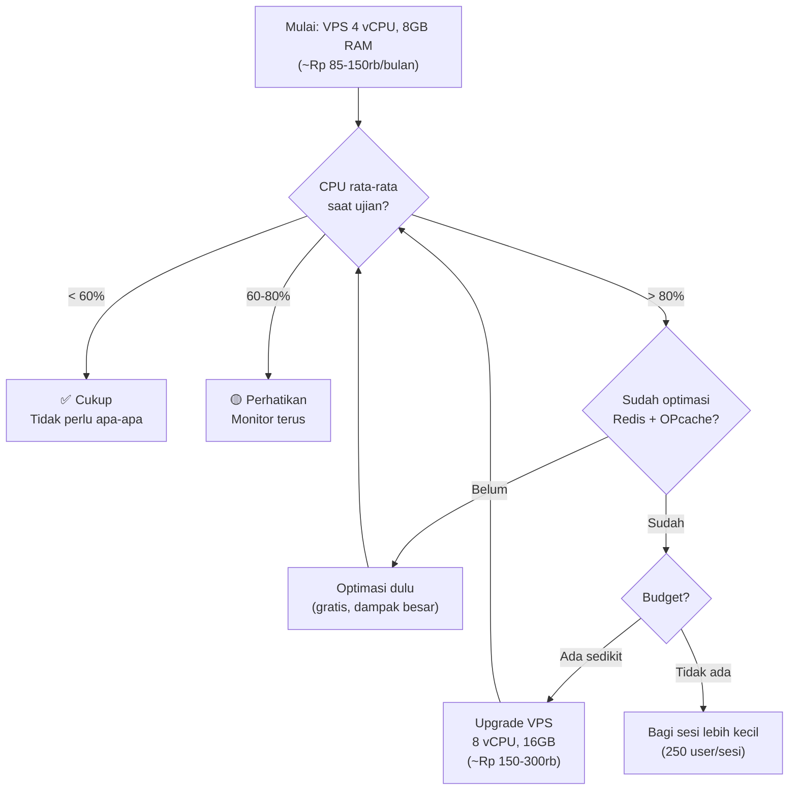

# Tech Stack & Infrastruktur: Scaling G-English CBT untuk 1.000–4.000 User/Hari
## Dokumen Strategi Infrastruktur — Budget Minimum

> **Tujuan:** Menentukan tech stack yang gratis/murah, aman, dan mampu melayani 1.000–4.000 user per hari untuk sistem CBT (TPA, TKA, Diagnostik, dll) sekaligus mempertahankan fungsi manajemen internal (siswa, tutor, keuangan, absensi).
>
> **Prinsip:** Pertahankan Laravel + Filament yang sudah dibangun. Optimasi infrastruktur, bukan menulis ulang kode. Semua software **gratis/open-source**.

---

## Daftar Isi

1. [Analisis Beban Sistem](#1-analisis-beban-sistem)
2. [Tech Stack Final](#2-tech-stack-final)
3. [Detail Setiap Layer](#3-detail-setiap-layer)
4. [Simulasi Beban & Kapasitas](#4-simulasi-beban--kapasitas)
5. [Opsi Server (VPS) & Perbandingan Harga](#5-opsi-server-vps--perbandingan-harga)
6. [Keamanan (Semua Gratis)](#6-keamanan-semua-gratis)
7. [Backup Strategy (Gratis)](#7-backup-strategy-gratis)
8. [Optimasi Laravel Production](#8-optimasi-laravel-production)
9. [Optimasi MySQL](#9-optimasi-mysql)
10. [Optimasi PHP-FPM](#10-optimasi-php-fpm)
11. [Kenapa Tidak Ganti Framework?](#11-kenapa-tidak-ganti-framework)
12. [Skenario Budget](#12-skenario-budget)
13. [Checklist Deployment Production](#13-checklist-deployment-production)
14. [Roadmap Infrastruktur](#14-roadmap-infrastruktur)

---

## 1. Analisis Beban Sistem

### 1.1 Dua Jenis Beban yang Berbeda

```
┌──────────────────────────────────────────────────────────┐
│                    G-ENGLISH SYSTEM                       │
│                                                           │
│  ┌─────────────────────┐  ┌────────────────────────────┐ │
│  │  BAGIAN 1:          │  │  BAGIAN 2:                 │ │
│  │  MANAJEMEN INTERNAL │  │  CBT ENGINE                │ │
│  │                     │  │                            │ │
│  │  • Data Siswa       │  │  • TPA (Tes Potensi       │ │
│  │  • Data Tutor       │  │    Akademik)               │ │
│  │  • Absensi QR       │  │  • TKA (Tes Kemampuan     │ │
│  │  • Jurnal Mengajar  │  │    Akademik)               │ │
│  │  • Keuangan/SPP     │  │  • Tes Diagnostik         │ │
│  │  • Payroll Tutor    │  │  • Kuis Harian            │ │
│  │  • Jadwal Kelas     │  │  • Ujian Sertifikasi      │ │
│  │                     │  │                            │ │
│  │  👤 ~5-20 user/hari │  │  👥 1.000-4.000 user/hari │ │
│  │  (admin, tutor)     │  │  (siswa ujian)             │ │
│  │  BEBAN: RINGAN      │  │  BEBAN: BERAT              │ │
│  └─────────────────────┘  └────────────────────────────┘ │
└──────────────────────────────────────────────────────────┘
```

> **Kesimpulan:** 95% beban server berasal dari CBT. Strategi optimasi difokuskan ke situ.

### 1.2 Profil Request CBT

Saat 1.000 siswa mengerjakan ujian bersamaan, inilah yang terjadi di server:

| Aktivitas | Frekuensi | Request/menit | Berat/Ringan |
|---|---|---|---|
| Login | Sekali | ~200/mnt (burst 5 menit) | 🟡 Sedang |
| Load soal | Sekali | ~200/mnt (burst) | 🟢 Ringan (cacheable) |
| Render soal | Setiap pindah soal | ~500/mnt | 🟢 Ringan (client-side) |
| Auto-save jawaban | Setiap 30 detik | ~2.000/mnt | 🟡 Sedang |
| Sinkronisasi timer | Setiap 5 menit | ~200/mnt | 🟢 Ringan |
| Log pelanggaran | Jarang | ~10/mnt | 🟢 Sangat ringan |
| Submit akhir | Sekali (burst) | ~200/mnt (peak) | 🟡 Sedang |
| **TOTAL PEAK** | | **~3.000/mnt** | **~50 req/detik** |

**50 request/detik** — ini **sangat achievable** untuk Laravel yang dioptimasi dengan benar.

---

## 2. Tech Stack Final

### 2.1 Diagram Arsitektur Lengkap

```
┌─────────────────────────────────────────────────────────────────┐
│                     ARSITEKTUR PRODUCTION                       │
│                                                                  │
│                                                                  │
│  [User Browser]                                                  │
│       │                                                          │
│       ▼                                                          │
│  ┌──────────────────────┐                                       │
│  │    CLOUDFLARE CDN    │  ← Layer 1: CDN + DDoS + SSL (GRATIS)│
│  │    (Free Plan)       │                                       │
│  │                      │                                       │
│  │  • Cache static file │                                       │
│  │  • DDoS protection   │                                       │
│  │  • SSL/HTTPS auto    │                                       │
│  │  • Edge di Jakarta   │                                       │
│  └──────────┬───────────┘                                       │
│             │ (hanya dynamic request yang diteruskan)            │
│             ▼                                                    │
│  ┌──────────────────────┐                                       │
│  │       NGINX          │  ← Layer 2: Web Server (GRATIS)      │
│  │                      │                                       │
│  │  • Reverse proxy     │                                       │
│  │  • Serve static file │                                       │
│  │  • Gzip compression  │                                       │
│  │  • Rate limiting     │                                       │
│  └──────────┬───────────┘                                       │
│             │                                                    │
│             ▼                                                    │
│  ┌──────────────────────┐                                       │
│  │     PHP 8.3 FPM      │  ← Layer 3: Runtime (GRATIS)        │
│  │                      │                                       │
│  │  • 30 worker proses  │                                       │
│  │  • OPcache aktif     │                                       │
│  │  • JIT compiler      │                                       │
│  └──────────┬───────────┘                                       │
│             │                                                    │
│             ▼                                                    │
│  ┌──────────────────────┐                                       │
│  │    LARAVEL 13        │  ← Layer 4: Framework (GRATIS)       │
│  │    + FILAMENT 5      │                                       │
│  │                      │                                       │
│  │  • Admin Panel       │                                       │
│  │  • Tutor Panel       │                                       │
│  │  • Student Panel     │                                       │
│  │  • CBT Engine        │                                       │
│  │  • API Endpoints     │                                       │
│  └────┬─────────┬───────┘                                       │
│       │         │                                                │
│       ▼         ▼                                                │
│  ┌─────────┐  ┌─────────────┐                                   │
│  │ MySQL 8 │  │   Redis 7   │  ← Layer 5 & 6: Data (GRATIS)   │
│  │         │  │             │                                   │
│  │ • Data  │  │ • Session   │                                   │
│  │   utama │  │ • Cache     │                                   │
│  │ • Soal  │  │ • Queue     │                                   │
│  │ • Nilai │  │ • Rate limit│                                   │
│  └─────────┘  └─────────────┘                                   │
│                                                                  │
│  OS: Ubuntu 22.04 LTS (GRATIS)                                  │
└─────────────────────────────────────────────────────────────────┘
```

### 2.2 Tabel Tech Stack

| Layer | Teknologi | Versi | Fungsi | Biaya |
|---|---|---|---|---|
| CDN & Security | Cloudflare | Free Plan | CDN, DDoS, SSL, edge caching | **Rp 0** |
| Web Server | Nginx | 1.24+ | Reverse proxy, static files, gzip | **Rp 0** |
| Runtime | PHP | 8.3 | Eksekusi kode + OPcache + JIT | **Rp 0** |
| Process Manager | PHP-FPM | 8.3 | Mengelola worker PHP paralel | **Rp 0** |
| Framework | Laravel | 13.x | Backend logic, routing, ORM | **Rp 0** |
| Admin Panel | Filament | 5.x | UI admin, tutor, student | **Rp 0** |
| Database | MySQL | 8.x | Penyimpanan data utama | **Rp 0** |
| In-Memory Store | Redis | 7.x | Session, cache, queue | **Rp 0** |
| OS | Ubuntu | 22.04 LTS | Sistem operasi server | **Rp 0** |
| SSL | Let's Encrypt / Cloudflare | - | Sertifikat HTTPS | **Rp 0** |
| Backup | rclone + Google Drive | - | Backup offsite otomatis | **Rp 0** |
| Monitoring | Laravel Pulse / Netdata | - | Pantau server real-time | **Rp 0** |
| Load Testing | k6 / Locust | - | Simulasi ribuan user | **Rp 0** |
| **TOTAL SOFTWARE** | | | | **Rp 0** |

---

## 3. Detail Setiap Layer

### 3.1 Cloudflare Free Plan

**Apa itu?** Cloudflare berdiri di depan server Anda sebagai "perisai" dan "akselerator".

```
                 TANPA Cloudflare              DENGAN Cloudflare

 4000 User ──► Server Anda               4000 User ──► Cloudflare ──► Server Anda
               (semua beban                             │
                ke server)                              ├─ Static files (CSS/JS/gambar)
                                                        │  dilayani Cloudflare
                                                        │  server TIDAK terbebani
                                                        │
                                                        ├─ DDoS Protection
                                                        │  serangan ditolak otomatis
                                                        │
                                                        └─ SSL/HTTPS otomatis gratis
```

**Fitur Free Plan yang relevan:**

| Fitur | Keterangan |
|---|---|
| CDN Global | Cache CSS, JS, gambar di 200+ kota (termasuk Jakarta) |
| DDoS Protection | Unlimited, otomatis |
| SSL/TLS | Sertifikat gratis, auto-renew |
| Page Rules (3 gratis) | Custom caching rules |
| Bot Protection | Blokir bot jahat |
| Analytics | Traffic analytics dasar |
| Bandwidth | **Unlimited** (tidak ada batas) |

**Dampak nyata untuk G-English:**
- ~60-70% request (static files) **tidak sampai ke server Anda**
- Latency berkurang karena edge server di Jakarta
- HTTPS otomatis tanpa konfigurasi

---

### 3.2 Nginx

**Kenapa Nginx, bukan Apache?**

| Aspek | Apache | Nginx |
|---|---|---|
| Arsitektur | 1 thread/process per koneksi | Event-driven (1 thread = ribuan koneksi) |
| Memory (1000 koneksi) | ~1GB | ~50MB |
| Serve static files | Lambat | **Sangat cepat** |
| Concurrent connections | ~500 (default) | **10.000+** |
| Reverse proxy | Plugin (mod_proxy) | **Built-in, sangat efisien** |

**Konfigurasi Nginx yang direkomendasikan:**

```nginx
# /etc/nginx/sites-available/g-english

server {
    listen 80;
    server_name g-english.com;
    root /var/www/g-english/public;
    index index.php;

    # Gzip compression — hemat bandwidth 60-80%
    gzip on;
    gzip_types text/plain text/css application/json application/javascript;
    gzip_min_length 1000;

    # Cache static files — browser cache 30 hari
    location ~* \.(css|js|jpg|jpeg|png|gif|ico|svg|woff2)$ {
        expires 30d;
        add_header Cache-Control "public, immutable";
    }

    # PHP handling — teruskan ke PHP-FPM
    location ~ \.php$ {
        fastcgi_pass unix:/run/php/php8.3-fpm.sock;
        fastcgi_param SCRIPT_FILENAME $realpath_root$fastcgi_script_name;
        include fastcgi_params;
    }

    # Laravel routing
    location / {
        try_files $uri $uri/ /index.php?$query_string;
    }

    # Blokir akses ke file sensitif
    location ~ /\.env { deny all; }
    location ~ /\.git { deny all; }
}
```

---

### 3.3 PHP 8.3 + PHP-FPM

**PHP-FPM** (FastCGI Process Manager) memungkinkan PHP memproses banyak request secara paralel.

```
Cara kerja PHP-FPM:

Nginx menerima request
    │
    ├── File static (CSS/JS/gambar)? → Nginx serve langsung ✅
    │
    └── Request PHP? → teruskan ke PHP-FPM
                            │
                      ┌─────▼─────┐
                      │  PHP-FPM   │
                      │  Pool:     │
                      │            │
                      │  Worker 1  ──► request siswa A
                      │  Worker 2  ──► request siswa B
                      │  Worker 3  ──► request siswa C
                      │  ...        │
                      │  Worker 30 ──► request siswa Z
                      │            │
                      └────────────┘

30 worker = 30 request PHP diproses BERSAMAAN
```

**OPcache** — akselerator PHP built-in:

```
TANPA OPcache:
  Request → PHP baca file .php → Compile ke bytecode → Eksekusi → Response
  (compile ulang SETIAP request)

DENGAN OPcache:
  Request pertama → PHP compile → Simpan bytecode di MEMORI
  Request ke-2,3,...999 → Langsung eksekusi dari memori (skip compile)
  Speedup: 2-3x lebih cepat
```

---

### 3.4 Redis — "Swiss Army Knife"

Redis menggantikan **3 fungsi sekaligus** yang saat ini pakai database:

```
┌───────────────────────────────────────────────────────────┐
│                        REDIS                               │
│                                                            │
│  ┌────────────────┐  ┌─────────────┐  ┌───────────────┐  │
│  │    SESSION      │  │    CACHE    │  │    QUEUE      │  │
│  │                │  │             │  │               │  │
│  │ Saat ini:      │  │ Saat ini:   │  │ Saat ini:     │  │
│  │ SESSION_DRIVER │  │ CACHE_STORE │  │ QUEUE_CONN    │  │
│  │ = database ❌  │  │ = database ❌│  │ = sync ❌     │  │
│  │                │  │             │  │               │  │
│  │ Seharusnya:    │  │ Seharusnya: │  │ Seharusnya:   │  │
│  │ = redis ✅     │  │ = redis ✅  │  │ = redis ✅    │  │
│  │                │  │             │  │               │  │
│  │ Dampak:        │  │ Dampak:     │  │ Dampak:       │  │
│  │ 50x lebih cepat│  │ 100x cepat  │  │ Non-blocking  │  │
│  │ per session op │  │ per cache op│  │ background    │  │
│  └────────────────┘  └─────────────┘  └───────────────┘  │
│                                                            │
│  Total RAM usage: ~200-500MB untuk 4.000 user              │
│  Speed: ~0.1ms per operasi (vs ~5ms database)              │
└───────────────────────────────────────────────────────────┘
```

**Perbandingan dampak perpindahan:**

| Metrik | Database Driver (saat ini) | Redis Driver (target) | Improvement |
|---|---|---|---|
| Session read | ~5ms | ~0.1ms | **50x lebih cepat** |
| Session write | ~8ms | ~0.1ms | **80x lebih cepat** |
| Cache hit | ~5ms | ~0.05ms | **100x lebih cepat** |
| DB queries per request | 2-4 query (session+cache) | 0 query | **Beban MySQL turun drastis** |
| Queue processing | Blocking (sync) | Background (async) | **Response time turun** |

**Perubahan di `.env`:**
```env
SESSION_DRIVER=redis
CACHE_STORE=redis
QUEUE_CONNECTION=redis

REDIS_HOST=127.0.0.1
REDIS_PASSWORD=null
REDIS_PORT=6379
```

**Instalasi Redis:**
```bash
# Ubuntu
sudo apt update
sudo apt install redis-server
sudo systemctl enable redis-server

# Verifikasi
redis-cli ping
# Output: PONG
```

---

## 4. Simulasi Beban & Kapasitas

### 4.1 Skenario: 1.000 User per Sesi

```
Timeline satu sesi ujian (1.5 jam):

08:00 ─┤ 1000 user login bersamaan
       │ → 1000 requests dalam 5 menit
       │ → ~200 req/menit → ~3.3 req/detik
       │ → PHP-FPM 30 worker: SANGAT SANTAI
       │
08:05 ─┤ 1000 user load soal
       │ → Soal di-cache Redis: 1 query MySQL pertama,
       │   999 sisanya dari cache
       │ → ~200 req/menit
       │
08:05  │ Auto-save berjalan
  ─    │ → 1000 user × 1 save / 30 detik
09:25  │ → ~33 request/detik (steady state)
       │ → PHP-FPM 30 worker: masing-masing ~1 req/detik
       │ → MySQL: ~33 UPSERT/detik (ringan)
       │
09:25 ─┤ BURST: 1000 user submit (5 menit terakhir)
  ─    │ → ~200 submit/menit → ~3.3 submit/detik
09:30  │ → Hitung skor + simpan + queue sync
       │ → PHP: ~100ms per submit → 30 worker CUKUP
       │
09:30 ─┤ Queue worker proses sync ke Google Forms
       │ → Background, TIDAK blokir response ke siswa
```

### 4.2 Estimasi Resource Usage

#### Server 4 vCPU, 8GB RAM:

| Resource | Idle | 1.000 user (sesi) | Peak (submit burst) | 4.000 user (semua bareng) |
|---|---|---|---|---|
| **CPU** | 5% | 30-50% | 70-80% | ⚠️ 90%+ |
| **RAM** | 1.5GB | 3-4GB | 4-5GB | ⚠️ 6-7GB |
| **MySQL koneksi** | 5 | 30-40 | 50 | ⚠️ 80-100 |
| **Redis memory** | 10MB | 100MB | 200MB | 400MB |
| **Network** | 1 Mbps | 10-20 Mbps | 30 Mbps | 50 Mbps |

#### Kesimpulan per skenario:

| Skenario | Server Minimum | Status |
|---|---|---|
| 250 user/sesi (4 sesi/hari = 1.000) | 2 vCPU, 2GB RAM | 🟢 Sangat mudah |
| 500 user/sesi (2 sesi/hari = 1.000) | 2 vCPU, 4GB RAM | 🟢 Mudah |
| 1.000 user/sesi | 4 vCPU, 8GB RAM | 🟢 Cukup |
| 2.000 user/sesi | 4 vCPU, 8GB RAM | 🟡 Bisa, tapi ketat |
| 4.000 user sekaligus | 8 vCPU, 16GB RAM | 🟡 Perlu tuning serius |

### 4.3 Kapan Perlu Scale Up?



---

## 5. Opsi Server (VPS) & Perbandingan Harga

### 5.1 Tabel Perbandingan Provider

#### Internasional (Murah, Server Luar Negeri):

| Provider | Spek | Harga/bulan | Lokasi | Latency ke ID | Catatan |
|---|---|---|---|---|---|
| **Contabo VPS S** | 4 vCPU, 8GB, 200GB SSD | €4.99 (~Rp 85rb) | Jerman | ~180ms | ⭐ Value terbaik |
| **Contabo VPS M** | 6 vCPU, 16GB, 400GB SSD | €8.99 (~Rp 150rb) | Jerman | ~180ms | Headroom lega |
| **Hetzner CX22** | 2 vCPU, 4GB, 40GB NVMe | €3.99 (~Rp 65rb) | Jerman/Singapura | ~30ms (SG) | Murah, NVMe cepat |
| **Hetzner CX32** | 4 vCPU, 8GB, 80GB NVMe | €7.49 (~Rp 125rb) | Singapura | ~30ms | ⭐ Rekomendasi |
| **RackNerd** | 3 vCPU, 4GB, 80GB SSD | $24/tahun (~Rp 30rb/bln) | US | ~250ms | Paling murah |
| **Vultr Regular** | 2 vCPU, 4GB, 80GB SSD | $24/bulan (~Rp 390rb) | Singapura | ~30ms | Mahal tapi dekat |
| **DigitalOcean** | 2 vCPU, 4GB, 80GB SSD | $24/bulan (~Rp 390rb) | Singapura | ~30ms | Mahal tapi bagus |

#### Indonesia (Latency Terbaik):

| Provider | Spek | Harga/bulan | Lokasi | Latency | Catatan |
|---|---|---|---|---|---|
| **IDCloudHost** | 2 vCPU, 4GB RAM | ~Rp 150rb | Jakarta | ~5-15ms | Lokal, support bahasa Indonesia |
| **Dewaweb** | Cloud VPS | ~Rp 150-300rb | Jakarta | ~5-15ms | Managed, ada support |
| **Biznet Gio** | 2 vCPU, 4GB RAM | ~Rp 130rb | Jakarta | ~5-15ms | Infrastruktur bagus |
| **CloudKilat** | 2 vCPU, 4GB RAM | ~Rp 150rb | Jakarta | ~5-15ms | Lokal |

#### Gratis (Terbatas):

| Provider | Spek | Biaya | Batasan |
|---|---|---|---|
| **Oracle Cloud Free Tier** | 4 vCPU ARM, 24GB RAM | **GRATIS SELAMANYA** | Sulit dapat (sering penuh). Prosesor ARM (perlu compile ulang beberapa extension) |
| **Google Cloud Free** | e2-micro (0.25 vCPU, 1GB) | Gratis 1 tahun | Terlalu kecil |
| **AWS Free Tier** | t2.micro (1 vCPU, 1GB) | Gratis 12 bulan | Setelah itu bayar. Terlalu kecil |

### 5.2 Rekomendasi per Budget

```
💰 ULTRA BUDGET (Rp 65-85rb/bulan):
   → Hetzner CX22 Singapura (Rp 65rb) — jika 500 user/sesi cukup
   → Contabo VPS S (Rp 85rb) — jika butuh RAM lebih (8GB)

💰💰 OPTIMAL (Rp 125-150rb/bulan):             ⭐ REKOMENDASI
   → Hetzner CX32 Singapura (Rp 125rb) — 4 vCPU, 8GB, NVMe, dekat Indonesia
   → IDCloudHost Jakarta (Rp 150rb) — latency terbaik, support lokal

💰💰💰 PREMIUM (Rp 300rb+/bulan):
   → Hanya jika butuh 4.000+ user bersamaan tanpa pembagian sesi

🆓 GRATIS:
   → Oracle Cloud Free Tier — jika beruntung dapat instance
```

### 5.3 Dampak Latency terhadap Pengalaman Ujian

| Lokasi Server | Latency | Dampak pada CBT |
|---|---|---|
| **Jakarta** | 5-15ms | Tidak terasa, instant |
| **Singapura** | 25-40ms | Tidak terasa |
| **Jerman/EU** | 150-200ms | Terasa sedikit saat klik jawaban (tapi acceptable) |
| **US West** | 200-300ms | Terasa, tapi masih bisa digunakan |

> **Catatan:** Karena CBT menggunakan **auto-save async** (bukan save per klik), latency tinggi **tidak terlalu mengganggu**. Soal ditampilkan dari cache lokal browser, dan jawaban dikirim di background. Yang penting latency **konsisten** dan tidak putus-putus.

---

## 6. Keamanan (Semua Gratis)

### 6.1 Matriks Keamanan per Layer

```
┌────────────────────────────────────────────────────────────────┐
│                    LAPISAN KEAMANAN                             │
│                                                                 │
│  Layer 1: NETWORK                                              │
│  ├── Cloudflare DDoS Protection ─────────────── GRATIS        │
│  ├── Cloudflare WAF (Web App Firewall) basic ── GRATIS        │
│  ├── SSL/HTTPS (Cloudflare / Let's Encrypt) ─── GRATIS        │
│  └── UFW Firewall (Ubuntu built-in) ──────────── GRATIS       │
│      → Buka hanya port: 80 (HTTP), 443 (HTTPS), 22 (SSH)     │
│                                                                 │
│  Layer 2: SERVER                                               │
│  ├── SSH key-only authentication ──────────────── GRATIS       │
│  │   → Disable password login                                  │
│  ├── Fail2ban ─────────────────────────────────── GRATIS       │
│  │   → Auto-blokir IP setelah 5x gagal login                  │
│  ├── Unattended upgrades ──────────────────────── GRATIS       │
│  │   → Auto-install security patches                           │
│  └── Non-root user ───────────────────────────── GRATIS        │
│      → Jangan jalankan app sebagai root                        │
│                                                                 │
│  Layer 3: APLIKASI                                             │
│  ├── CSRF Protection (Laravel built-in) ───────── GRATIS      │
│  ├── SQL Injection Prevention (Eloquent ORM) ──── GRATIS      │
│  ├── XSS Prevention (Blade auto-escape) ───────── GRATIS      │
│  ├── Rate Limiting (ThrottleRequests) ─────────── GRATIS       │
│  ├── Input Validation (FormRequest) ───────────── GRATIS       │
│  ├── Password Hashing (Bcrypt, sudah aktif) ──── GRATIS       │
│  ├── Session Hijacking Prevention ─────────────── GRATIS       │
│  │   → SESSION_ENCRYPT=true, SESSION_SECURE=true              │
│  └── CORS Configuration ──────────────────────── GRATIS        │
│                                                                 │
│  Layer 4: DATABASE                                             │
│  ├── MySQL user privileges (least privilege) ──── GRATIS      │
│  ├── MySQL bind to localhost only ─────────────── GRATIS       │
│  ├── Encrypted connections (TLS) ──────────────── GRATIS       │
│  └── Regular backups (mysqldump + cron) ───────── GRATIS       │
│                                                                 │
│  Layer 5: MONITORING                                           │
│  ├── Laravel Pulse (production monitoring) ────── GRATIS       │
│  ├── Netdata (server metrics) ─────────────────── GRATIS       │
│  └── Log rotation (logrotate, built-in) ───────── GRATIS      │
│                                                                 │
│  TOTAL BIAYA KEAMANAN: Rp 0                                   │
└────────────────────────────────────────────────────────────────┘
```

### 6.2 Setup Keamanan Server (Command)

```bash
# 1. Firewall
sudo ufw default deny incoming
sudo ufw default allow outgoing
sudo ufw allow 22/tcp    # SSH
sudo ufw allow 80/tcp    # HTTP
sudo ufw allow 443/tcp   # HTTPS
sudo ufw enable

# 2. Fail2ban (anti brute-force)
sudo apt install fail2ban
sudo systemctl enable fail2ban

# 3. Auto security updates
sudo apt install unattended-upgrades
sudo dpkg-reconfigure -plow unattended-upgrades

# 4. Disable password SSH login
# Edit /etc/ssh/sshd_config:
#   PasswordAuthentication no
#   PermitRootLogin no
sudo systemctl restart sshd

# 5. MySQL: bind to localhost only
# /etc/mysql/mysql.conf.d/mysqld.cnf:
#   bind-address = 127.0.0.1

# 6. Redis: bind to localhost only
# /etc/redis/redis.conf:
#   bind 127.0.0.1
#   requirepass your_redis_password_here
```

---

## 7. Backup Strategy (Gratis)

### 7.1 Arsitektur Backup

```
┌──────────────────────────────────────────────────────────────┐
│                    BACKUP STRATEGY                            │
│                                                               │
│  ┌─────────────────────────────────────────────────────────┐ │
│  │  Cron Job: Setiap hari jam 02:00 WIB                   │ │
│  │                                                          │ │
│  │  1. mysqldump --single-transaction g-english             │ │
│  │     → /backup/db_$(date +%Y-%m-%d).sql.gz               │ │
│  │                                                          │ │
│  │  2. tar czf /backup/storage_$(date).tar.gz               │ │
│  │     /var/www/g-english/storage/app/public                │ │
│  │                                                          │ │
│  │  3. rclone sync /backup/ gdrive:g-english-backup/        │ │
│  │     → Upload ke Google Drive (15GB GRATIS)               │ │
│  │                                                          │ │
│  │  4. find /backup/ -mtime +7 -delete                      │ │
│  │     → Hapus backup lokal > 7 hari                        │ │
│  └─────────────────────────────────────────────────────────┘ │
│                                                               │
│  Estimasi ukuran per hari:                                    │
│  • Database dump: ~50-200MB (compressed)                     │
│  • Storage files: ~100MB-1GB (foto, attachment)              │
│  • Total: ~200MB-1.2GB/hari                                  │
│                                                               │
│  Google Drive 15GB gratis = ~15-75 hari backup               │
│  (rotasi: hapus yang > 7 hari, jadi selalu cukup)            │
│                                                               │
│  Alternatif gratis:                                           │
│  • Cloudflare R2: 10GB gratis/bulan                          │
│  • Backblaze B2: 10GB gratis selamanya                       │
└──────────────────────────────────────────────────────────────┘
```

### 7.2 Script Backup

```bash
#!/bin/bash
# /var/www/scripts/backup.sh

BACKUP_DIR="/var/www/backups"
DATE=$(date +%Y-%m-%d)
DB_NAME="g-english"
STORAGE_PATH="/var/www/g-english/storage/app/public"

# 1. Backup database
mysqldump --single-transaction --quick $DB_NAME | gzip > "$BACKUP_DIR/db_$DATE.sql.gz"

# 2. Backup storage files (foto, attachment)
tar czf "$BACKUP_DIR/storage_$DATE.tar.gz" $STORAGE_PATH

# 3. Upload ke Google Drive via rclone
rclone sync "$BACKUP_DIR" gdrive:g-english-backup/

# 4. Hapus backup lokal > 7 hari
find "$BACKUP_DIR" -type f -mtime +7 -delete

echo "Backup completed: $DATE"
```

```bash
# Tambah ke crontab:
# crontab -e
0 2 * * * /var/www/scripts/backup.sh >> /var/log/backup.log 2>&1
```

---

## 8. Optimasi Laravel Production

### 8.1 Command Optimasi (Wajib di Production)

```bash
# Jalankan SETELAH setiap deploy:

# 1. Cache config — hemat ~100ms/request
php artisan config:cache

# 2. Cache routes — hemat ~50ms/request
php artisan route:cache

# 3. Cache views — hemat ~20ms/request
php artisan view:cache

# 4. Cache events
php artisan event:cache

# 5. Atau semuanya sekaligus:
php artisan optimize

# 6. Optimasi autoloader Composer
composer install --optimize-autoloader --no-dev
```

### 8.2 Konfigurasi OPcache

```ini
; /etc/php/8.3/fpm/conf.d/10-opcache.ini

opcache.enable=1
opcache.memory_consumption=128
opcache.interned_strings_buffer=16
opcache.max_accelerated_files=10000
opcache.validate_timestamps=0          ; PRODUCTION: jangan cek file tiap request
opcache.revalidate_freq=0
opcache.jit=1255                       ; Aktifkan JIT compiler (PHP 8+)
opcache.jit_buffer_size=64M
```

**Dampak OPcache + JIT:**

| Tanpa OPcache | Dengan OPcache | Dengan OPcache + JIT |
|---|---|---|
| ~200ms/request | ~80ms/request | ~50ms/request |
| PHP compile setiap request | Skip compile | Skip compile + native code |

### 8.3 Database Indexing (CBT-Specific)

```sql
-- Index yang WAJIB ditambahkan untuk performa CBT:

-- 1. cbt_questions: cari soal per exam
CREATE INDEX idx_questions_exam ON cbt_questions(cbt_exam_id);

-- 2. cbt_attempts: cari attempt per siswa per exam
CREATE INDEX idx_attempts_student_exam ON cbt_attempts(student_id, cbt_exam_id);

-- 3. cbt_attempts: cari attempt aktif
CREATE INDEX idx_attempts_status ON cbt_attempts(status, cbt_exam_id);

-- 4. cbt_answers: cari jawaban per attempt (auto-save & submit)
CREATE INDEX idx_answers_attempt ON cbt_answers(cbt_attempt_id);

-- 5. cbt_answers: cegah duplikat jawaban per soal per attempt
CREATE UNIQUE INDEX idx_answers_attempt_question ON cbt_answers(cbt_attempt_id, cbt_question_id);
```

### 8.4 Eager Loading (Cegah N+1 Query)

```
MASALAH N+1:

$exam = CbtExam::find(1);
foreach ($exam->questions as $q) {    // 1 query per soal!
    echo $q->question_text;
}
// Exam 50 soal = 51 queries ❌

SOLUSI EAGER LOADING:

$exam = CbtExam::with('questions')->find(1);  // 2 queries total ✅
// 1 query: SELECT * FROM cbt_exams WHERE id = 1
// 1 query: SELECT * FROM cbt_questions WHERE cbt_exam_id = 1
```

### 8.5 Caching Soal Ujian

```
STRATEGI:

Saat ujian dimulai:
  $questions = Cache::remember(
      "exam:{$examId}:questions",
      now()->addHours(3),             // Cache selama 3 jam
      fn() => CbtExam::with('questions')->find($examId)
  );

Dampak:
  1000 siswa load soal yang sama
  → TANPA cache: 1000 query MySQL
  → DENGAN cache: 1 query MySQL + 999 dari Redis
  → Penghematan: 999 query = beban MySQL turun 99.9%
```

---

## 9. Optimasi MySQL

### 9.1 Konfigurasi Production

```ini
# /etc/mysql/mysql.conf.d/mysqld.cnf

[mysqld]
# === MEMORY ===
# Buffer Pool — PALING PENTING
# Untuk server 8GB RAM total:
innodb_buffer_pool_size = 2G           # ~25-30% RAM total
                                        # (sisanya untuk PHP, Redis, OS)

innodb_buffer_pool_instances = 2        # 2 instance untuk parallelism

# === PERFORMANCE ===
innodb_log_file_size = 256M
innodb_flush_log_at_trx_commit = 2     # Sedikit kurangi durability untuk speed
                                        # (2 = flush setiap detik, bukan setiap commit)
innodb_flush_method = O_DIRECT          # Bypass OS cache (pakai buffer pool)

# === CONNECTIONS ===
max_connections = 100                   # 30 PHP-FPM + 10 queue + buffer
wait_timeout = 300                      # Tutup koneksi idle setelah 5 menit
interactive_timeout = 300

# === QUERY OPTIMIZATION ===
join_buffer_size = 4M
sort_buffer_size = 4M
read_rnd_buffer_size = 2M

# === LOGGING ===
slow_query_log = 1
long_query_time = 1                     # Log query > 1 detik
slow_query_log_file = /var/log/mysql/slow.log

# === SECURITY ===
bind-address = 127.0.0.1               # Hanya akses lokal
```

---

## 10. Optimasi PHP-FPM

### 10.1 Konfigurasi Pool

```ini
; /etc/php/8.3/fpm/pool.d/www.conf

[www]
user = www-data
group = www-data

listen = /run/php/php8.3-fpm.sock

; === PROCESS MANAGEMENT ===
pm = dynamic
pm.max_children = 30          ; Maks 30 proses PHP paralel
pm.start_servers = 10         ; Mulai dengan 10
pm.min_spare_servers = 5      ; Minimum 5 standby
pm.max_spare_servers = 15     ; Maksimum 15 standby
pm.max_requests = 500         ; Restart worker setiap 500 request
                               ; (cegah memory leak)

; === MEMORY CALCULATION ===
; Rata-rata 1 PHP worker = 30-50MB
; 30 worker × 50MB = 1.5GB untuk PHP
; Server 8GB:
;   - PHP-FPM: 1.5GB
;   - MySQL:   2GB (buffer pool)
;   - Redis:   0.5GB
;   - OS:      1.5GB
;   - Buffer:  2.5GB (headroom)
;   TOTAL:     8GB ✅

; === TIMEOUTS ===
request_terminate_timeout = 120        ; Kill request > 2 menit
                                        ; (cegah proses zombie)

; === STATUS (untuk monitoring) ===
pm.status_path = /fpm-status
```

### 10.2 Panduan Tuning `pm.max_children`

```
Rumus kasar:
  max_children = (RAM tersedia untuk PHP) / (RAM per worker)

Contoh:
  Server 8GB total
  - MySQL: 2GB
  - Redis: 0.5GB
  - OS: 1.5GB
  = Sisa untuk PHP: 4GB

  RAM per worker Laravel: ~40-60MB (rata-rata 50MB)
  max_children = 4000MB / 50MB = 80

  TAPI: terlalu banyak worker = CPU overload
  Jadi batasi: max_children = vCPU × 7-10
  Untuk 4 vCPU: max_children = 28-40

  REKOMENDASI: 30 (sweet spot)
```

---

## 11. Kenapa Tidak Ganti Framework?

### 11.1 Perbandingan Jujur

| Tech | Performa Mentah | Biaya Migrasi | Admin Panel Ready | Ekosistem | Verdict |
|---|---|---|---|---|---|
| **Laravel (current)** | ⭐⭐⭐ Cukup | Rp 0 (sudah pakai) | Filament ⭐⭐⭐⭐⭐ | Sangat mature | ✅ **PERTAHANKAN** |
| Node.js / Express | ⭐⭐⭐⭐ | 🔴 Tulis ulang 100% | Harus bikin sendiri | Fragmented | ❌ |
| Go / Gin | ⭐⭐⭐⭐⭐ | 🔴 Tulis ulang 100% | Tidak ada | Minimalis | ❌ |
| Next.js | ⭐⭐⭐ | 🔴 Tulis ulang 100% | Harus bikin sendiri | Frontend-focused | ❌ |
| Django (Python) | ⭐⭐⭐ | 🔴 Tulis ulang 100% | Django Admin (OK) | Bagus | ❌ |
| Ruby on Rails | ⭐⭐⭐ | 🔴 Tulis ulang 100% | ActiveAdmin (OK) | Mature | ❌ |

### 11.2 Alasan Utama Pertahankan Laravel

1. **Biaya migrasi >> biaya optimasi**
   - Menulis ulang ke Node.js: 2-4 bulan kerja (Rp XX juta jika hire developer)
   - Optimasi Laravel: 1-2 minggu (Rp 0 jika Anda sendiri)

2. **Laravel yang dioptimasi ≈ Node.js untuk use-case ini**
   - 50 req/detik? Laravel + OPcache + Redis: santai
   - Node.js unggul di 10.000+ req/detik — Anda tidak butuh itu

3. **Filament = unfair advantage**
   - Admin panel, tutor panel, student panel — sudah jadi
   - Di framework lain, ini harus dibangun dari nol (berminggu-minggu kerja)

4. **Ekosistem Laravel lengkap**
   - Queue, cache, session, auth, validation, ORM — semua built-in
   - Di Node.js, harus pilih dan integrasikan sendiri puluhan library

---

## 12. Skenario Budget

### Skenario A: "Paling Murah" — Rp 100rb/bulan

```
┌────────────────────────────────────────────────┐
│  SKENARIO A: ULTRA BUDGET                      │
│                                                 │
│  Server:     Contabo VPS S            Rp 85.000│
│              4 vCPU, 8GB RAM                    │
│              200GB SSD, Jerman                  │
│                                                 │
│  Domain:     .com (per tahun)         Rp 12.500│
│              (Rp 150rb / 12 bulan)              │
│                                                 │
│  SSL:        Cloudflare               Rp     0 │
│  CDN:        Cloudflare               Rp     0 │
│  Software:   Semua open-source        Rp     0 │
│  Backup:     Google Drive + rclone    Rp     0 │
│  Monitoring: Netdata                  Rp     0 │
│                                                 │
│  ─────────────────────────────────────────────  │
│  TOTAL:      ~Rp 100.000/bulan                 │
│                                                 │
│  Kapasitas:  1.000 user/sesi                    │
│  Catatan:    Latency ~180ms (Jerman)           │
│              Acceptable untuk CBT async         │
└────────────────────────────────────────────────┘
```

### Skenario B: "Optimal" — Rp 150-200rb/bulan ⭐ REKOMENDASI

```
┌────────────────────────────────────────────────┐
│  SKENARIO B: OPTIMAL                    ⭐     │
│                                                 │
│  Server:     Hetzner CX32 (Singapura) Rp125.000│
│              4 vCPU, 8GB RAM, NVMe              │
│              ATAU                                │
│              IDCloudHost (Jakarta)     Rp150.000│
│              2-4 vCPU, 4-8GB RAM                │
│                                                 │
│  Domain:     .com                     Rp 12.500│
│  SSL:        Cloudflare               Rp     0 │
│  CDN:        Cloudflare               Rp     0 │
│  Software:   Semua open-source        Rp     0 │
│  Backup:     Google Drive + rclone    Rp     0 │
│  Monitoring: Laravel Pulse            Rp     0 │
│                                                 │
│  ─────────────────────────────────────────────  │
│  TOTAL:      ~Rp 150.000-200.000/bulan         │
│                                                 │
│  Kapasitas:  1.000-2.000 user/sesi              │
│  Catatan:    Latency ~30ms (Singapura)          │
│              atau ~15ms (Jakarta)               │
│              Pengalaman cepat & responsif       │
└────────────────────────────────────────────────┘
```

### Skenario C: "Gratis Total" (Eksperimental)

```
┌────────────────────────────────────────────────┐
│  SKENARIO C: GRATIS                            │
│                                                 │
│  Server:     Oracle Cloud Free Tier   Rp     0 │
│              4 vCPU ARM, 24GB RAM               │
│              (SELAMANYA gratis)                  │
│                                                 │
│  Domain:     Subdomain gratis atau    Rp     0 │
│              beli .com (Rp 12.500)              │
│  SSL:        Cloudflare               Rp     0 │
│  CDN:        Cloudflare               Rp     0 │
│  Software:   Semua open-source        Rp     0 │
│  Backup:     Google Drive + rclone    Rp     0 │
│                                                 │
│  ─────────────────────────────────────────────  │
│  TOTAL:      Rp 0 - 12.500/bulan               │
│                                                 │
│  ⚠️ CATATAN:                                   │
│  - Oracle Free Tier SANGAT sulit didapat        │
│  - Prosesor ARM: perlu pastikan extension OK    │
│  - Tidak ada SLA / jaminan uptime               │
│  - Cocok untuk development/testing              │
│  - TIDAK direkomendasikan untuk production      │
└────────────────────────────────────────────────┘
```

---

## 13. Checklist Deployment Production

### 13.1 Sebelum Go-Live

```
SERVER SETUP:
[ ] VPS sudah aktif (Ubuntu 22.04 LTS)
[ ] SSH key-only authentication
[ ] UFW firewall aktif (port 80, 443, 22)
[ ] Fail2ban terinstall & aktif
[ ] Unattended-upgrades aktif

SOFTWARE STACK:
[ ] Nginx terinstall & configured
[ ] PHP 8.3 + PHP-FPM terinstall
[ ] OPcache + JIT aktif
[ ] MySQL 8 terinstall & tuned
[ ] Redis 7 terinstall & secured
[ ] Composer dependencies installed (--no-dev)
[ ] Node.js + npm (untuk Vite build)

LARAVEL PRODUCTION:
[ ] .env → APP_ENV=production
[ ] .env → APP_DEBUG=false
[ ] .env → SESSION_DRIVER=redis
[ ] .env → CACHE_STORE=redis
[ ] .env → QUEUE_CONNECTION=redis
[ ] php artisan optimize
[ ] php artisan storage:link
[ ] Database migration sudah jalan
[ ] Database index sudah ditambahkan

CLOUDFLARE:
[ ] Domain sudah pointing ke Cloudflare
[ ] SSL mode: Full (Strict)
[ ] Cache level: Standard
[ ] Always Use HTTPS: ON
[ ] Auto Minify: ON

BACKUP:
[ ] rclone configured ke Google Drive
[ ] Cron backup script aktif
[ ] Test restore backup berhasil

MONITORING:
[ ] Laravel Pulse / Netdata terinstall
[ ] Slow query log MySQL aktif
[ ] Laravel log rotation aktif

LOAD TESTING:
[ ] k6 / Locust test: 300+ concurrent users
[ ] Peak submit burst test berhasil
[ ] Auto-save stress test berhasil
[ ] Timer accuracy test berhasil
```

### 13.2 Deploy Script

```bash
#!/bin/bash
# /var/www/scripts/deploy.sh
# Jalankan setiap kali deploy update kode

cd /var/www/g-english

# 1. Pull latest code
git pull origin main

# 2. Install dependencies
composer install --optimize-autoloader --no-dev

# 3. Run migrations
php artisan migrate --force

# 4. Clear & rebuild caches
php artisan optimize:clear
php artisan optimize
php artisan filament:optimize

# 5. Build frontend assets
npm ci
npm run build

# 6. Restart services
sudo systemctl restart php8.3-fpm
sudo systemctl restart nginx

# 7. Restart queue workers
php artisan queue:restart

echo "Deploy completed at $(date)"
```

---

## 14. Roadmap Infrastruktur

### Fase 1: Setup Dasar (Minggu 1)
```
[ ] Pilih & sewa VPS
[ ] Install Ubuntu 22.04 LTS
[ ] Setup SSH key, firewall, fail2ban
[ ] Install Nginx + PHP 8.3 + PHP-FPM
[ ] Install MySQL 8
[ ] Install Redis 7
[ ] Deploy kode Laravel
[ ] Setup Cloudflare (DNS, SSL)
```

### Fase 2: Optimasi (Minggu 2)
```
[ ] Konfigurasi PHP-FPM (30 workers)
[ ] Aktifkan OPcache + JIT
[ ] Tuning MySQL (buffer pool, connections)
[ ] Ubah .env: session, cache, queue → Redis
[ ] Tambahkan database indexes (CBT tables)
[ ] php artisan optimize
[ ] Setup Nginx caching untuk static files
```

### Fase 3: Keamanan & Backup (Minggu 2-3)
```
[ ] Redis password + bind localhost
[ ] MySQL bind localhost + user privileges
[ ] Setup rclone ke Google Drive
[ ] Buat backup cron script
[ ] Test restore backup
[ ] Install monitoring (Laravel Pulse / Netdata)
```

### Fase 4: Testing & Validasi (Minggu 3)
```
[ ] Load test: 100 user concurrent → cek response time
[ ] Load test: 500 user concurrent → cek CPU & RAM
[ ] Load test: 1000 user concurrent → stress test
[ ] Test auto-save under load
[ ] Test submit burst under load
[ ] Identifikasi & fix bottleneck
[ ] Ujian percobaan dengan siswa sungguhan (10-50 siswa)
```

### Fase 5: Go-Live (Minggu 4)
```
[ ] Full deploy production
[ ] Monitoring aktif saat ujian pertama
[ ] Standby untuk troubleshoot
[ ] Dokumentasi runbook (apa yang harus dilakukan jika X terjadi)
```

---

> **Ringkasan Eksekutif:** Pertahankan Laravel + Filament. Tambahkan Nginx + PHP-FPM + Redis + OPcache + Cloudflare (semua gratis). Sewa VPS Rp 100-200rb/bulan. Sistem akan mampu melayani 1.000-4.000 user/hari dengan aman, cepat, dan profesional. Total biaya: **Rp 100.000 – 200.000/bulan** (hanya biaya VPS + domain).
